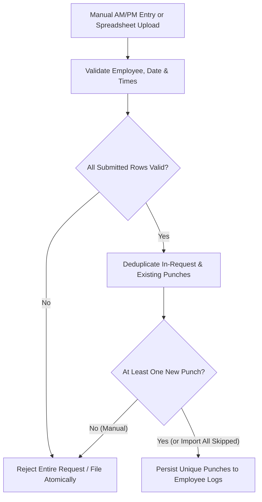
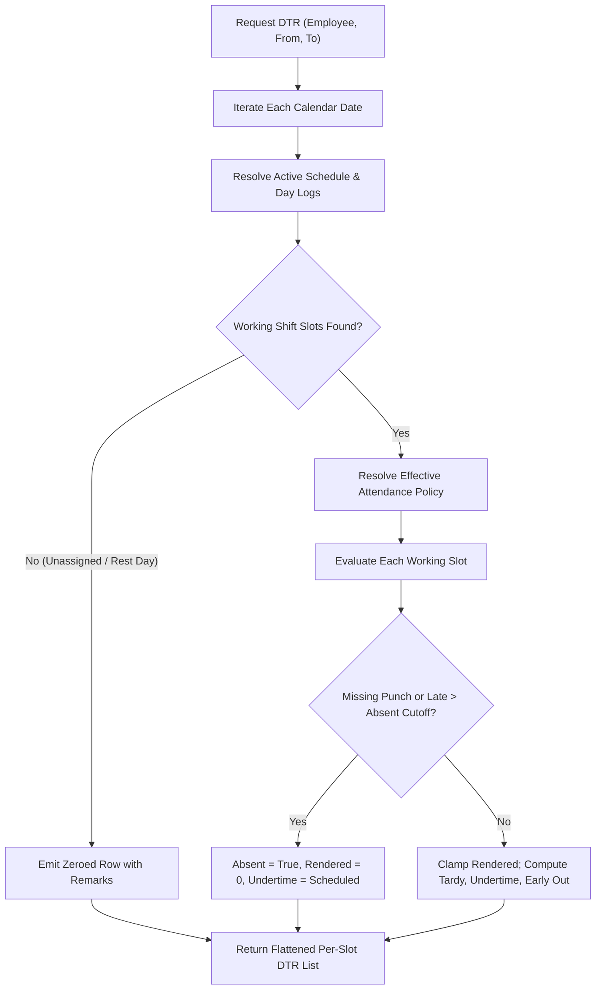
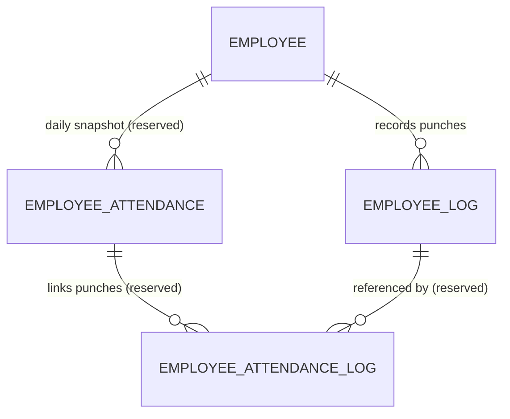

# Attendance and Logs

## 1. Purpose & Actors

Attendance and Logs captures raw employee time-punch events—from biometric devices, manual HR entry, bulk spreadsheet imports, and approved time correction applications—and computes per-shift-slot Daily Time Records (DTR) across any requested date range, evaluating scheduled vs rendered duration, tardiness, undertime, early departure, and absence.

- **Administrator / HR Timekeeper:** Views any employee's DTR, records manual single or paired AM/PM punches, downloads the standard import spreadsheet template, and uploads bulk attendance log files.
- **Employee:** Views their own DTR summary and daily attendance breakdown.
- **Biometric Devices & Correction Applications (External / Cross-Module):** Supply raw time-punch records (`biometric` and `correction` sources) into the shared employee log store.

---

## 2. Process Flow

*Caption: Raw time-punch ingestion, whole-file validation, and deduplication flow.*

*Caption: On-the-fly per-slot Daily Time Record (DTR) evaluation flow.*

### Step-by-Step Workflow

1. **Manual Punch Entry:** HR selects an employee and submits either a single exact timestamp or a calendar date with any combination of `am_in`, `am_out`, `pm_in`, and `pm_out` times plus an optional device label (default `MANUAL-ENTRY`). The system deduplicates submitted timestamps, skips any `(employee_id, logged_at)` pairs already stored, rejects the request if zero new punches remain, and inserts new rows with `source = manual`.
2. **Spreadsheet Template & Atomic Bulk Import:** HR downloads the standard `.xlsx` template and uploads a `.xlsx`, `.xls`, or `.csv` file (up to 10 MB) containing Date, Employee ID, and AM/PM Time In and Time Out columns. The system strips header rows, validates every data row upfront (employee exists, valid date, at least one valid time), and aborts atomically with row-level error details if any row fails. Valid files skip in-file and database duplicates and insert all unique punches in one transaction (`source = excel_import`, `device_id = EXCEL-UPLOAD`).
3. **On-the-Fly DTR Calculation:** For each calendar date in `[from, to]`, the system resolves the employee's active schedule for that ISO weekday and fetches all punches on that date in chronological order. Unassigned dates, dates with missing weekday details, or rest days emit a single zeroed row with descriptive remarks. Working days resolve the effective attendance policy and evaluate each shift slot: earliest punch as `time_in`, latest punch (when at least two punches exist) as `time_out`, clamping rendered time to the overlap of `[time_in, time_out]` with `[sched_start, sched_end]`, and computing tardiness, undertime, early departure, and absence.

---

## 3. Logical Data Schema

*Caption: Active raw punch log store and reserved persisted daily attendance snapshot entities.*

### Employee Log (`employee_logs` — Active Runtime Store)

| Field | Type | Required | Default | Constraints & Relationships | Purpose |
|---|---|---|---|---|---|
| `id` | `integer` | Yes | Auto-increment | PK | Surrogate punch-log identifier |
| `employee_id` | `string(30)` | Yes | — | FK -> `employees.employee_id` (`Restrict`); Indexed with `logged_at` | Employee who recorded the punch |
| `logged_at` | `datetime` | Yes | — | Indexed alone and with `employee_id` | Exact date and time of the punch |
| `device_id` | `string(100)` | No | Null | — | Optional biometric terminal or import batch label |
| `source` | `enum(biometric, manual, excel_import, correction)` | Yes | `biometric` | Stored as `string(30)` | Origin channel of the punch record |
| `created_at` | `datetime` | No | Null | — | Record creation timestamp |
| `updated_at` | `datetime` | No | Null | — | Record last-update timestamp |

### Employee Attendance (`employee_attendance` — Reserved Snapshot Schema, Unused at Runtime)

| Field | Type | Required | Default | Constraints & Relationships | Purpose |
|---|---|---|---|---|---|
| `id` | `integer` | Yes | Auto-increment | PK | Surrogate daily attendance identifier |
| `employee_id` | `string(30)` | Yes | — | FK -> `employees.employee_id` (`Restrict`); Unique with `date` | Employee business key |
| `date` | `date` | Yes | — | Unique with `employee_id`; Indexed with `status` | Calendar date of attendance |
| `schedule_id` | `integer` | No | Null | FK -> `schedules.id` (`Restrict`) | Schedule template snapshot applied to the date |
| `sched_start` | `time` | No | Null | — | Scheduled start time snapshot |
| `sched_end` | `time` | No | Null | — | Scheduled end time snapshot |
| `time_in` | `time` | No | Null | — | Computed first time-in for the date |
| `time_out` | `time` | No | Null | — | Computed last time-out for the date |
| `scheduled_seconds` | `integer` | Yes | `0` | Non-negative | Total scheduled work duration in seconds |
| `rendered_seconds` | `integer` | Yes | `0` | Non-negative | Total rendered work duration in seconds |
| `absent` | `boolean` | Yes | `false` | — | Absence indicator flag |
| `tardy_seconds` | `integer` | Yes | `0` | Non-negative | Total tardiness duration in seconds |
| `undertime` | `boolean` | Yes | `false` | — | Undertime indicator flag |
| `undertime_seconds` | `integer` | Yes | `0` | Non-negative | Total undertime duration in seconds |
| `early_dismiss` | `boolean` | Yes | `false` | — | Early-dismissal indicator flag |
| `holiday` | `boolean` | Yes | `false` | — | Holiday indicator flag |
| `suspended` | `boolean` | Yes | `false` | — | Work-suspension indicator flag |
| `remarks` | `text` | No | Null | — | Free-text attendance remarks |
| `status` | `enum(pending, confirmed)` | Yes | `pending` | Stored as `string(30)`; Indexed with `date` | Confirmation lifecycle state |
| `details` | `text` | No | Null | Structured breakdown payload | Optional per-slot calculation details |
| `confirmed_at` | `datetime` | No | Null | — | Timestamp when the attendance record was confirmed |
| `created_at` | `datetime` | No | Null | — | Record creation timestamp |
| `updated_at` | `datetime` | No | Null | — | Record last-update timestamp |

### Employee Attendance Log (`employee_attendance_logs` — Reserved Join Schema, Unused at Runtime)

| Field | Type | Required | Default | Constraints & Relationships | Purpose |
|---|---|---|---|---|---|
| `id` | `integer` | Yes | Auto-increment | PK | Surrogate link identifier |
| `employee_attendance_id` | `integer` | Yes | — | FK -> `employee_attendance.id` (`Cascade`); Unique with `employee_log_id`; Unique with `sequence` | Parent persisted attendance record |
| `employee_log_id` | `integer` | Yes | — | FK -> `employee_logs.id` (`Restrict`); Unique with `employee_attendance_id` | Referenced raw punch log |
| `sequence` | `integer` | Yes | — | Non-negative; Unique with `employee_attendance_id` | Ordinal position of punch within the day |
| `log_type` | `enum(in, out)` | Yes | — | Stored as `string(20)` | Classified punch direction |
| `created_at` | `datetime` | No | Null | — | Record creation timestamp |
| `updated_at` | `datetime` | No | Null | — | Record last-update timestamp |

---

## 4. Business Rules & Invariants

| # | Rule | Enforcement Requirement |
|---|---|---|
| 1 | **Valid DTR Query Range** | Target `employee_id` must exist, and `to` must be on or after `from`. |
| 2 | **Non-Working Day Output** | Unassigned dates, dates lacking weekday shift details, and rest days emit 1 zeroed row (`scheduled_seconds = 0`, `rendered_seconds = 0`, `absent = false`) with remarks `No schedule`, `No schedule details`, or `Rest day`. |
| 3 | **Absence on Missing Punch or Zero Rendered Time** | If zero punches exist, only one punch exists (no `time_out`), or clamped `rendered_seconds = 0`, the slot is marked `absent = true`, `rendered_seconds = 0`, `undertime_seconds = scheduled_seconds`, and `remarks = absent`. |
| 4 | **Late-to-Absent Policy Cutoff** | When `absent_after_late_seconds` is configured and `time_in > sched_start + absent_after_late_seconds`, the slot is marked `absent = true`, `rendered_seconds = 0`, `tardy_seconds = 0`, `undertime_seconds = scheduled_seconds`, while retaining recorded `time_in` and `time_out`. |
| 5 | **Tardy Grace & Counting Origin** | Tardy cutoff uses slot `tardy_start` if present, else `sched_start + tardy_grace_seconds`. When `time_in > tardy_cutoff`, tardiness accrues from `tardy_cutoff` (`after_grace`) or from `sched_start` (`schedule_start`); otherwise `0`. |
| 6 | **Undertime & Early-Out Rules** | Undertime cutoff uses slot `undertime_start` if present, else `sched_end - undertime_grace_seconds`. When `time_out < undertime_cutoff`, `undertime_seconds = min(sched_end - time_out, scheduled_seconds)`. Early-out compares `time_out` against `early_dismissal_start` (or `sched_end`). |
| 7 | **Rendered Duration Clamping** | Rendered seconds are clamped strictly to the overlap of `[time_in, time_out]` with `[sched_start, sched_end]`; early arrivals and late departures do not inflate regular rendered time. |
| 8 | **Manual Entry Deduplication** | Manual submissions deduplicate timestamps and skip existing `(employee_id, logged_at)` pairs; submitting zero net-new punches is rejected. |
| 9 | **Atomic Whole-File Spreadsheet Import** | Accepts `.xlsx`, `.xls`, or `.csv` up to 10 MB. All data rows are validated before persistence; any invalid row aborts the entire upload with row-level errors. Duplicate punches are skipped without failing valid uploads. |
| 10 | **Raw Log Immutability** | The Attendance module provides no direct edit or delete actions on raw logs; only the Time Correction workflow may replace or revert correction punches. |

---

## 5. User Interface Capabilities

### Attendance Tab
- **Filter Bar:** Schedule-type segmented control (`All types`, `Monthly`, `Semi-monthly`), searchable employee picker for administrators (locked read-only badge for employees), cut-off schedule and period preset selectors (auto-filling `From` and `To` dates), and manual `From` / `To` date pickers.
- **KPI Summary Strip:** 5 summary cards displaying `Rendered hours`, `Present days`, `Absent days` (excluding dates where at least one shift slot rendered time), `Total tardy`, and `Total undertime`.
- **DTR Table:** Toolbar with row count badge, employee/date subtitle, `Refresh`, `Print DTR`, status filter pills (`All Logs`, `Present`, `Absent`, `Late / Undertime`, `Rest Day`), and text search. Columns: `Date`, `Scheduled Shift`, `Time In`, `Time Out`, `Rendered`, `Late`, `Undertime`, `Status / Remarks` badge, plus a footer totals row.

### Manage In/Out Tab
- **Raw Logs Table:** Server-paginated table with columns `Logged at`, `Employee`, `Source` badge (`Manual`, `Excel import`, `Biometric`, or `Correction`), `Device`, and `Uploaded / Recorded`. Supports source filter, log date range filter, and free-text search (employee ID, name, device, source).
- **Add / Import Logs Dialog (Create Permission):**
  - **Manual Log Time Tab:** Employee selector, log date (default today), optional device/label, AM In/Out and PM In/Out time pickers, with `Save & Add Another` and `Save Log` actions.
  - **Upload Spreadsheet Tab:** `Download Template` button, drag-and-drop or file picker (`.xlsx`, `.xls`, `.csv`, max 10 MB), inline display of row-level validation errors, and `Upload Logs` action.

---

## 6. Rebuild Notes

- **Split-Shift, Overnight & Tap-Window DTR Engine:** Currently, DTR evaluation reuses the entire day's earliest and latest punches across all split-shift slots, filters strictly by single calendar date without overnight rollover or schedule timezone awareness, and ignores policy tap-window tolerances (`early_in_window_seconds`, `late_out_window_seconds`, `duplicate_tap_window_seconds`). Settle the exact punch-to-slot pairing algorithm before rebuilding.
- **Persisted DTR Snapshots & Confirmation:** Decide whether to activate `employee_attendance` and `employee_attendance_logs` to persist and lock confirmed DTR periods, rather than computing DTR exclusively on the fly.
- **Cross-Module Timekeeping Integrations:** Approved Leave, Official Business / WFH, Overtime, Holidays, and Work Suspensions are not yet wired into DTR calculations. Define how each adjusts absence, rendered hours, and remarks.
- **Server-Side Self-Scoping & Query Caps:** Enforce self-only employee scoping on the server for non-admin DTR and raw log queries (not just in the UI), add a maximum date-range cap on DTR requests, and record `created_by` attribution for manual and imported logs.
- **Correction Source Filtering:** Include `correction` as a selectable option in the Manage In/Out table's source filter dropdown.
