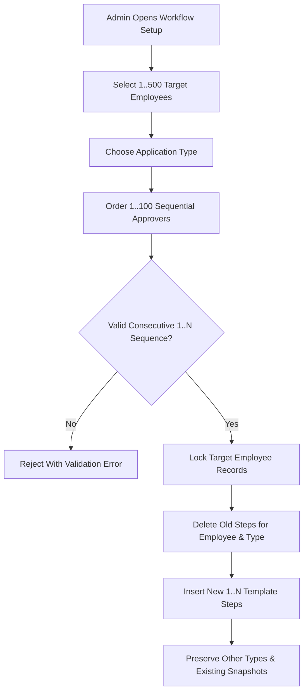
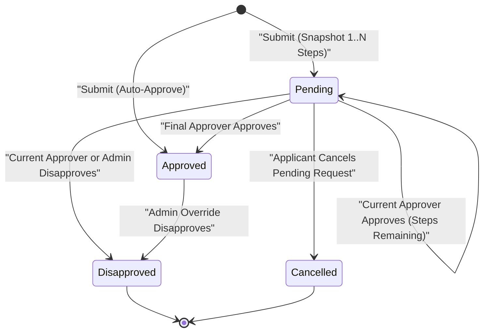
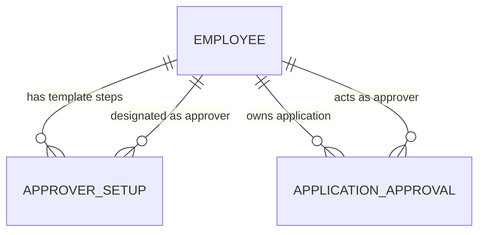

# Approver Setup & Shared Approval Engine

## 1. Purpose & Actors

The Approver Setup and Shared Approval Engine module provides centralized configuration of ordered, multi-level approval chains per employee and application type, paired with a reusable runtime approval engine used across Overtime, Official Business, Attendance Correction, and Leave applications. Once an application is submitted, its approval chain is frozen as an immutable point-in-time snapshot so later administrative changes never alter in-flight or historical requests.

### Actors

- **Administrators:** Users with approver-setup view and update permissions. They browse configured approval chains, create or replace single-employee or bulk multi-employee chains per application type, and hold override authority to disapprove pending or already-approved applications across all four online application modules.
- **Applicants:** Employees who submit online applications (and may cancel their own pending requests). They do not need access to Approver Setup administration.
- **Assigned Approvers:** Employees designated in an application's snapshotted approval sequence who approve or disapprove requests strictly when it is their turn in the sequence.

---

## 2. Process Flow

*Caption: Administrative workflow for configuring and atomically replacing per-employee approval chain templates.*

*Caption: Shared runtime status lifecycle enforced across all four online application types.*

### Template Configuration Workflow

1. An administrator opens the Approver Setup screen (directly or via an actionable deep-link from a missing-approver submission error) and chooses to create a new workflow or edit an existing employee-and-type chain.
2. The administrator selects one or more target employees (up to 500 in a single save), chooses one of the four supported application types (Overtime, Official Business, Attendance Correction, or Leave), and defines an ordered sequence of 1 to 100 approvers.
3. The system validates that all target employees and approvers exist and that step sequence numbers form a consecutive 1-based range (`1..N`) with no gaps or duplicates.
4. Inside an atomic transaction, the system locks the target employee records to serialize concurrent updates, deletes only the existing template steps for the selected employee and application-type pairs, and inserts the replacement `1..N` steps. Other application types for the same employees and all existing runtime approval snapshots remain untouched.

### Runtime Approval Snapshotting & Decision Workflow

1. **Submission Snapshot:** When an application requires approval, the owning module creates the parent application in `pending` status and invokes the shared snapshot process inside the same transaction. The engine locks the applicant's employee record, the parent application, and the matching template rows, verifies a valid consecutive `1..N` chain exists, and copies each step into the runtime approval table in `pending` status. If no valid template exists, the entire submission rolls back with a validation error.
2. **Auto-Approval Bypass:** When an application is submitted with approver workflow disabled, the parent application is saved directly in `approved` status and no runtime approval steps are created.
3. **Sequential Approval:** Only an actor whose employee identity matches the earliest `pending` step may approve (and all lower-numbered steps must already be `approved`). Approving records optional remarks and the action timestamp; the parent application remains `pending` until every step is `approved`, at which point the parent transitions to `approved`. Administrators cannot bypass another approver's turn to approve.
4. **Approver Disapproval:** The current pending approver may disapprove their step with optional remarks. The step and parent application immediately transition to `disapproved`, while any later steps remain `pending` with no action timestamp as an audit record of where the chain halted.
5. **Administrator Disapproval Override:** An administrator may disapprove any `pending` or `approved` application regardless of whether they are in the chain. If a `pending` step exists, the earliest pending step is marked `disapproved`; the parent transitions to `disapproved`, and the owning module runs any required reversal hooks (such as removing synced attendance logs or restoring leave credits) within the same transaction. Already `disapproved` or `cancelled` applications cannot be overridden.
6. **Applicant Cancellation:** Only the applicant employee may cancel an application, and only while its parent status is `pending`. All remaining `pending` steps transition to `cancelled` with the remarks and timestamp, prior `approved` steps stay intact for audit history, and the parent transitions to `cancelled`.

---

## 3. Logical Data Schema

*Caption: Logical relationship between employees, approval chain templates, and polymorphic runtime approval snapshots.*

### Entity: Approver Setup (Template Step)

| Field | Type | Required | Default | Constraints & Relationships | Purpose |
|---|---|---|---|---|---|
| `id` | `integer` | Yes | Auto-increment | Primary Key | Surrogate identifier for a template step. |
| `employee_id` | `string(30)` | Yes | — | Foreign Key -> Employee (`Cascade`); Unique with `(application_type, sequence)` | Applicant employee whose submissions use this chain. |
| `application_type` | `enum(overtime, official_business, correction, leave)` | Yes | — | Unique with `(employee_id, sequence)` | Target online application module. |
| `approver_id` | `string(30)` | Yes | — | Foreign Key -> Employee (`Restrict`) | Designated approver employee identifier. |
| `sequence` | `integer` | Yes | — | Unsigned, >= 1; Unique with `(employee_id, application_type)` | 1-based sequential approval order. |
| `created_at` | `datetime` | No | — | — | Record creation timestamp. |
| `updated_at` | `datetime` | No | — | — | Record last-update timestamp. |

### Entity: Application Approval (Runtime Snapshot Step)

| Field | Type | Required | Default | Constraints & Relationships | Purpose |
|---|---|---|---|---|---|
| `id` | `integer` | Yes | Auto-increment | Primary Key | Surrogate identifier for a runtime approval step. |
| `employee_id` | `string(30)` | Yes | — | Foreign Key -> Employee (`Cascade`); Indexed with `application_type` | Applicant employee identifier. |
| `application_type` | `enum(overtime, official_business, correction, leave)` | Yes | — | Unique with `(application_id, sequence)`; Indexed with `employee_id` | Discriminator identifying the parent application entity. |
| `application_id` | `integer` | Yes | — | Logical reference to parent application PK (polymorphic, no DB FK); Unique with `(application_type, sequence)` | Identifier of the parent application record. |
| `approver_id` | `string(30)` | Yes | — | Foreign Key -> Employee (`Restrict`); Indexed with `status` | Snapshotted approver employee identifier. |
| `sequence` | `integer` | Yes | — | Unsigned, >= 1; Unique with `(application_type, application_id)` | 1-based step position in the approval sequence. |
| `status` | `enum(pending, approved, disapproved, cancelled)` | Yes | `pending` | Indexed with `approver_id` | Current decision state of this approval step. |
| `remarks` | `text` | No | — | Max 5,000 characters on decision input | Optional approver decision note or applicant cancellation reason. |
| `acted_at` | `datetime` | No | — | — | Timestamp when this step was acted upon or cancelled. |
| `created_at` | `datetime` | No | — | — | Record creation timestamp. |
| `updated_at` | `datetime` | No | — | — | Record last-update timestamp. |

---

## 4. Business Rules & Invariants

1. **Supported Application Types:** Only `overtime`, `official_business`, `correction`, and `leave` are valid application types. Any other value must be rejected.
2. **Consecutive 1-Based Sequences:** Every saved template and every snapshotted chain must contain at least one step (up to 100) whose sequence numbers equal `1..N` with no duplicates, zeros, or gaps.
3. **Scoped Atomic Replacement:** Saving a template for one or more employees and a specific application type replaces only the steps for those `(employee_id, application_type)` pairs; other application types and all existing runtime snapshots remain unchanged.
4. **Approver Referential Protection:** An employee record referenced as an `approver_id` in either templates or runtime approval history cannot be deleted (`Restrict`).
5. **Single Immutable Snapshot:** An application may be snapshotted at most once, only while `pending`, and only if no runtime approval rows already exist for it.
6. **Mandatory Template on Pending Filing:** Submitting any approval-required application without a valid consecutive template for that `(employee_id, application_type)` must fail and roll back the entire submission.
7. **Deadlock-Safe Serialization:** Template replacement and submission snapshotting must lock the applicant employee record(s) first within a transaction so concurrent edits and submissions never produce a mixed or partial chain.
8. **Employee-Bound Turn Authorization:** Step approval and non-admin disapproval authorize against the actor's linked employee identifier (so any user account bound to that employee may act). Only the earliest `pending` step's approver may act; out-of-turn attempts are forbidden.
9. **Admin Disapproval Override Only:** Administrators may disapprove any `pending` or `approved` application regardless of chain membership, but may never bypass the turn order to approve a pending step.
10. **Applicant-Only Pending Cancellation:** Only the applicant employee may cancel an application, and only while parent status is `pending`. Prior `approved` steps must remain `approved` when remaining `pending` steps are marked `cancelled`.
11. **Decision Remarks Limit:** Optional remarks on approve, disapprove, or cancel actions are capped at 5,000 characters.
12. **Distinct Approvers in Sequence:** The UI enforces that the same approver cannot appear twice in one workflow sequence.

---

## 5. User Interface Capabilities

- **Approver Setup Workspace (Permission-Gated):** Accessible only to users with approver-setup view permission; creation and editing controls require approver-setup update permission.
- **Grouped Workflow Table:** Collapses flat step records into one visual row per `(employee, application_type)` displaying the applicant's avatar, full name, and employee ID; an application-type badge; a horizontal sequence flow of numbered step pills (`1 -> 2 -> ...`) with each approver's name and ID; a hierarchy depth badge; and row-level View and Edit actions.
- **Search & Filtering:** Free-text search across applicant and approver names or employee IDs, plus an application-type filter covering Overtime, Official Business, Correction, and Leave.
- **Create / Edit / View Modal:**
  - Multi-select target employee picker with search, Select All, Clear, and removable chips (displaying up to 8 chips plus an overflow counter).
  - Four-card application-type selector (locked in view mode and when editing an existing workflow).
  - Ordered approver sequence builder supporting drag-and-drop reordering, adding steps, removing steps (disabled when only one step remains), and duplicate-approver validation.
  - Loading, empty, saving-in-progress, success-toast, and inline error states.
- **Cross-Module Deep-Link Recovery:** When any online application submission fails due to a missing approver setup, users with approver-setup view permission receive a warning notification containing a direct link that opens the Approver Setup create modal pre-selected to the relevant application type.
- **Shared Batch Decision Pattern:** All four online application screens support multi-select batch approve/disapprove bars that settle each selected item independently, keep failed items selected, and summarize succeeded versus failed counts.

---

## 6. Rebuild Notes

- **Backend Duplicate & Self-Approver Enforcement:** Decide whether to enforce distinct approvers per chain on the server (currently UI-only) and whether to prohibit self-approval (`employee_id = approver_id`).
- **Grouped Pagination & Sorting:** Paginate and sort by distinct `(employee_id, application_type)` workflow groups rather than raw flat step rows so page sizes match visible table rows, and align filter/sort query parameters cleanly.
- **Workflow Deletion & Audit Metadata:** Decide whether administrators should be able to delete or deactivate an employee's approval chain (currently no delete capability exists) and whether template records should track who created or last modified them.
- **Actionable Notifications:** Decide whether to trigger in-app, email, or push notifications whenever an approval step becomes active for the next approver or when a request is finalized.
