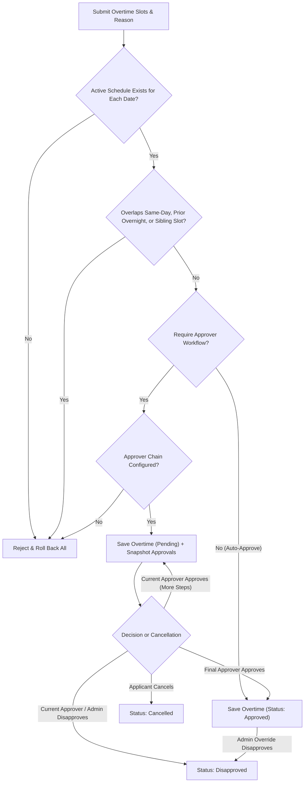
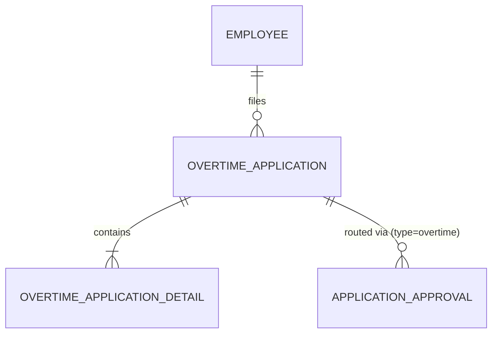

# Overtime Applications

## 1. Purpose & Actors

The Overtime Applications module enables employees and administrators to file structured overtime requests outside scheduled shift hours, automatically compute net overtime duration after unpaid break deductions, enforce shift and overnight non-overlap rules, and route requests through sequential multi-level approval chains.

### Actors

- **Employees:** Users with overtime view, create, and update permissions. They file overtime for themselves, view their own requests and requests awaiting their approval, cancel their own pending requests, and approve or disapprove steps where they are the current sequence approver.
- **Administrators:** Users with administrative authority (system administrator role, user-management view, or approver-setup view). They view all overtime applications company-wide, proxy-file for one or multiple employees in a single submission, optionally auto-approve on submission, and override-disapprove pending or approved overtime requests.

---

## 2. Process Flow

*Caption: End-to-end overtime submission, schedule and overlap validation, and sequential approval workflow.*

### Step-by-Step User & System Workflow

1. **Preconditions:** Every target employee must have an active assigned work schedule covering each requested overtime date, with a configured schedule entry for that day of the week (including explicit rest-day definitions). If approver workflow is enabled, a consecutive `1..N` overtime approver chain must exist for each target employee.
2. **Form Preparation:** An employee (self) or administrator (one or multiple employees) enters a business reason, selects the approval mode, and specifies one or more overtime detail rows (`date`, `start_time`, `end_time`, and `break_seconds`).
3. **Concurrency Locking:** Inside an atomic transaction, the system locks the assigned schedule templates first, followed by the target employee records and their employee-schedule assignments, preventing deadlocks during concurrent schedule edits or submissions.
4. **Schedule & Multi-Date Overlap Validation:** For every target employee and every detail row:
   - The system verifies `end_time` is strictly later than `start_time` and `break_seconds` is non-negative and strictly less than the gross slot duration.
   - The system resolves scheduled work shifts for both the target date and the immediately preceding date (to capture overnight shifts spilling past midnight into the target date, including onto rest days) in the application's configured timezone.
   - If the requested `[start_time, end_time]` overlaps any scheduled work shift or overlaps another detail slot on the same date within the same submission, the entire transaction rolls back.
   - The server computes `requested_seconds = (end_time - start_time) - break_seconds`, ignoring any client-supplied duration totals.
5. **Persistence & Approval Routing:**
   - If approver workflow is enabled, the application is saved in `pending` status with its detail rows, and the shared approval engine snapshots the employee's `overtime` approver chain.
   - If auto-approve is selected, the application is saved directly in `approved` status with no approval steps.
   - For multi-employee admin submissions, failure for any single employee rolls back the entire batch so zero applications are created.
6. **Sequential Decisions, Override & Cancellation:**
   - The current pending sequence approver approves or disapproves with optional remarks; final step approval transitions the application to `approved`, while any disapproval transitions it to `disapproved`.
   - An administrator may override-disapprove any `pending` or `approved` overtime request, but cannot bypass an approver's turn to approve.
   - The applicant may cancel their own `pending` overtime request.

---

## 3. Logical Data Schema

*Caption: Logical entities owned by Overtime Applications and their link to the shared approval snapshot table.*

### Entity: Overtime Application

| Field | Type | Required | Default | Constraints & Relationships | Purpose |
|---|---|---|---|---|---|
| `id` | `integer` | Yes | Auto-increment | Primary Key | Surrogate identifier for an overtime application. |
| `employee_id` | `string(30)` | Yes | — | Foreign Key -> Employee (`Cascade`); Indexed with `status` | Applicant employee identifier. |
| `reason` | `text` | Yes | — | Max 5,000 characters | Business justification for the overtime request. |
| `status` | `enum(pending, approved, disapproved, cancelled)` | Yes | `pending` | Indexed with `employee_id`; Server-controlled | Aggregate workflow status of the application. |
| `submitted_at` | `datetime` | Yes | Current timestamp | Server-controlled | Timestamp when the request was submitted. |
| `created_at` | `datetime` | No | — | — | Record creation timestamp. |
| `updated_at` | `datetime` | No | — | — | Record last-update timestamp. |

### Entity: Overtime Application Detail

| Field | Type | Required | Default | Constraints & Relationships | Purpose |
|---|---|---|---|---|---|
| `id` | `integer` | Yes | Auto-increment | Primary Key | Surrogate identifier for an overtime period slot. |
| `overtime_application_id` | `integer` | Yes | — | Foreign Key -> Overtime Application (`Cascade`); Indexed with `date` | Parent overtime application. |
| `date` | `date` | Yes | — | Indexed with `overtime_application_id` | Calendar date of the overtime work. |
| `start_time` | `time` | Yes | — | Must be earlier than `end_time` | Overtime period start time. |
| `end_time` | `time` | Yes | — | Must be later than `start_time` | Overtime period end time. |
| `break_seconds` | `integer` | Yes | `0` | Unsigned; strictly less than gross period seconds | Unpaid break deduction in seconds. |
| `requested_seconds` | `integer` | Yes | — | Unsigned; Server-computed (`gross - break`) | Net requested overtime duration in seconds. |
| `created_at` | `datetime` | No | — | — | Record creation timestamp. |
| `updated_at` | `datetime` | No | — | — | Record last-update timestamp. |

---

## 4. Business Rules & Invariants

1. **Ownership & Proxy Filing:** Non-administrators may submit overtime only for their own linked employee record. Administrators may submit for a single employee or a batch of multiple employees atomically.
2. **Mandatory Active Schedule:** Every requested overtime date must be covered by an active employee schedule that defines an entry for that day of the week. Rest days are eligible for overtime only when explicitly configured as rest days on the schedule.
3. **Positive Same-Day Time Window:** Every detail slot must have `end_time` strictly after `start_time`, and each submission must contain between 1 and 100 detail slots.
4. **Valid Break Deduction:** Break duration must be non-negative and strictly shorter than the slot's gross duration, ensuring net overtime is always positive.
5. **Shift & Overnight Non-Overlap:** An overtime slot must not overlap any scheduled work shift on the target date or any overnight shift that started on the previous day and extends into the target date.
6. **Intra-Submission Non-Overlap:** Two detail slots within the same submission cannot overlap on the same calendar date.
7. **Server-Computed Totals & Protected Fields:** Net `requested_seconds`, `status`, and `submitted_at` are strictly server-controlled; client attempts to supply `status` or `submitted_at` must be rejected.
8. **Visibility Scoping:** Non-administrators may view only applications they submitted or applications where they appear in the snapshotted approval chain; hidden records must behave as not found. Administrators have global visibility.
9. **Permission-Gated Decisions:** Even a configured sequence approver must hold overtime update permission to approve or disapprove.
10. **Immutable Content After Filing:** Overtime applications are never edited in place or soft-deleted; lifecycle changes update only status and approval step records.

---

## 5. User Interface Capabilities

- **Overtime Applications List Screen:**
  - Displays a paginated, sortable table with actionable selection checkboxes, applicant avatar/name/ID, submission timestamp, date and period summary, total net requested overtime (`Xh Ym`), status badge, and row-level View, Approve, Disapprove, and Cancel actions.
  - Provides free-text search (across reason, employee ID, applicant name, and approver name), status filter, and submitted-date filter.
  - Gates the **Apply Overtime** button behind overtime creation permission.
- **Floating Bulk Action Bar:** Appears when one or more actionable rows are selected; enables **Approve** only when every selected row awaits the user's approval turn, enables **Disapprove** when every selected row permits the user's disapproval, and retains failed rows selected on partial batch failure.
- **Apply Overtime Modal:**
  - Shows a multi-employee selector for administrators or a read-only current-employee badge for self-service users.
  - Provides an approval-mode toggle (`Approver` vs `Auto Approve`), date picker, dynamic start/end time slots with Add/Remove controls, break-deduction presets (No Break, 30 mins, 1 hour, 1.5 hours, or custom `HH:MM`) distributed sequentially across slots, and a required reason field with character counter.
  - Displays live Gross, Break, and Net OT summary badges and disables submission when net duration is zero or invalid.
  - Surfaces an actionable deep-link error hint to Approver Setup (pre-filtered to Overtime) when the target employee lacks an approver chain.
- **Overtime Detail View Modal:** Shows applicant identity, reason, a per-slot breakdown table (date, working window, break, net OT), the sequential approval pipeline with timestamps and remarks, and inline Remarks + Approve/Disapprove/Cancel controls when actionable.

---

## 6. Rebuild Notes

- **Restrict Auto-Approve to Administrators:** Currently both the server and UI allow non-administrators to submit with auto-approve enabled; the rebuild should strictly gate auto-approval to administrators (matching Leave Management).
- **Cross-Application Overlap Detection:** Currently only intra-submission slot overlaps are checked, allowing duplicate overtime across separate pending/approved requests; decide whether to enforce cross-application non-overlap matching Official Business.
- **Multi-Date UI & File Attachments:** The data model supports distinct dates per detail row while the filing modal currently binds one date across all slots, and the modal includes an unwired file-picker control; decide whether to expose per-row dates and whether Overtime should support private file attachments (with storage and download permissions).
- **Downstream DTR & Payroll Integration:** Approved overtime applications are not yet consumed by Daily Time Record (DTR) evaluation or payroll computation; define how approved overtime windows reconcile against actual attendance punches and cutoff locks.
- **Proxy-Filing Audit Trail:** Consider recording a separate `filed_by` actor identifier when an administrator proxy-files or auto-approves overtime on an employee's behalf.
