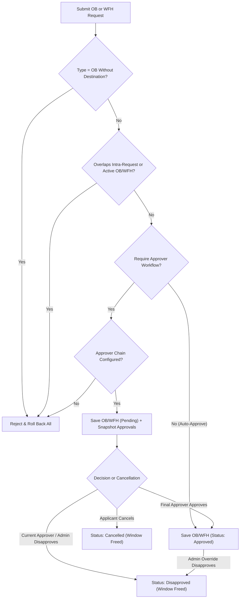
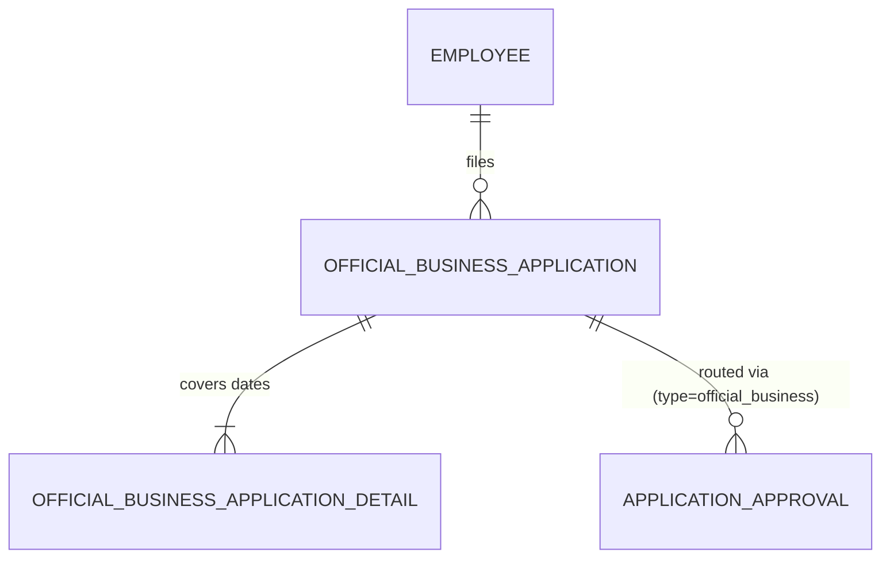

# Official Business & WFH Applications

## 1. Purpose & Actors

The Official Business and Work From Home (OB/WFH) module manages formal requests for off-site business assignments (`ob`) and remote work arrangements (`wfh`) with per-date time schedules, cross-request overlap prevention, and sequential multi-level approval workflows. Unlike Overtime, OB/WFH does not require a pre-existing assigned work schedule.

### Actors

- **Employees:** Users with Official Business view, create, and update permissions. They submit their own OB or WFH requests, view requests they filed or are assigned to approve, cancel their own pending requests, and approve or disapprove steps when it is their turn.
- **Administrators:** Users with administrative authority (system administrator role, user-management view, or approver-setup view). They view all OB/WFH applications across the organization, proxy-file for one or multiple employees in a single batch, optionally auto-approve on submission, and override-disapprove pending or approved requests.

---

## 2. Process Flow

*Caption: Official Business and WFH validation, overlap checking, and approval lifecycle.*

### Step-by-Step User & System Workflow

1. **Classification & Form Entry:** An employee (self) or administrator (one or multiple employees) selects the request type—**Official Business (`ob`)** or **Work From Home (`wfh`)**—enters a destination (mandatory for `ob`, optional for `wfh`), provides a purpose/reason, and adds one or more `(date, start_time, end_time)` schedule rows.
2. **Type & Destination Validation:** The system verifies that `ob_type` is valid, `destination` is non-empty when `ob_type` is `ob` (blank strings on `wfh` are normalized to empty/null), and every detail row has `end_time` strictly after `start_time`.
3. **Concurrency Locking & Overlap Validation:** Inside an atomic transaction for each target employee, the system locks the employee record and checks every requested time window against:
   - Other detail rows in the same submission sharing the same calendar date (non-overlapping split windows on the same date are allowed).
   - Existing `pending` or `approved` OB/WFH detail rows for the same employee and date. Previously `disapproved` or `cancelled` requests do not block re-filing.
   - If any employee in a multi-employee submission has a conflict or lacks an approver chain, the entire transaction rolls back and zero records are created.
4. **Persistence & Approval Snapshotting:**
   - When approver workflow is enabled, the system saves the application in `pending` status with its detail rows and snapshots the employee's `official_business` approver chain.
   - When auto-approve is selected, the system saves the application directly in `approved` status with no approval steps.
5. **Sequential Decisions, Override & Cancellation:**
   - Assigned approvers act strictly in sequence; final approval transitions the application to `approved`, while disapproval transitions it to `disapproved` and immediately frees the blocked time windows for re-filing.
   - Administrators may override-disapprove any `pending` or `approved` OB/WFH record (also freeing the time windows), but cannot bypass an approver's turn to approve.
   - Applicants may cancel their own `pending` requests, immediately freeing the time windows for re-filing.

---

## 3. Logical Data Schema

*Caption: Logical entities owned by Official Business & WFH Applications and their link to the shared approval snapshot table.*

### Entity: Official Business Application

| Field | Type | Required | Default | Constraints & Relationships | Purpose |
|---|---|---|---|---|---|
| `id` | `integer` | Yes | Auto-increment | Primary Key | Surrogate identifier for an OB/WFH application. |
| `employee_id` | `string(30)` | Yes | — | Foreign Key -> Employee (`Cascade`); Indexed with `status` | Applicant employee identifier. |
| `ob_type` | `enum(ob, wfh)` | Yes | `ob` | Indexed | Request category: Official Business (`ob`) or Work From Home (`wfh`). |
| `destination` | `string(255)` | Conditional | — | Required when `ob_type = ob`; optional/nullable when `ob_type = wfh` | Client, field site, or travel location. |
| `reason` | `text` | Yes | — | Max 5,000 characters | Purpose or activity summary for the request. |
| `status` | `enum(pending, approved, disapproved, cancelled)` | Yes | `pending` | Indexed with `employee_id`; Server-controlled | Aggregate workflow status of the application. |
| `submitted_at` | `datetime` | Yes | Current timestamp | Server-controlled | Timestamp when the request was submitted. |
| `created_at` | `datetime` | No | — | — | Record creation timestamp. |
| `updated_at` | `datetime` | No | — | — | Record last-update timestamp. |

### Entity: Official Business Application Detail

| Field | Type | Required | Default | Constraints & Relationships | Purpose |
|---|---|---|---|---|---|
| `id` | `integer` | Yes | Auto-increment | Primary Key | Surrogate identifier for a scheduled OB/WFH window. |
| `official_business_application_id` | `integer` | Yes | — | Foreign Key -> Official Business Application (`Cascade`); Indexed with `date` | Parent OB/WFH application. |
| `date` | `date` | Yes | — | Indexed with `official_business_application_id` | Calendar date covered by the request. |
| `start_time` | `time` | Yes | — | Must be earlier than `end_time` | Window start time. |
| `end_time` | `time` | Yes | — | Must be later than `start_time` | Window end time. |
| `created_at` | `datetime` | No | — | — | Record creation timestamp. |
| `updated_at` | `datetime` | No | — | — | Record last-update timestamp. |

---

## 4. Business Rules & Invariants

1. **Ownership & Proxy Filing:** Non-administrators may submit only for their own employee record. Administrators may file for one or multiple employees atomically in one request.
2. **OB vs WFH Destination Rule:** Requests classified as `ob` must include a non-empty destination (up to 255 characters). Requests classified as `wfh` may omit destination, with blank values stored as empty/null.
3. **Schedule Independence:** Unlike Overtime, OB/WFH filing does not require an active work schedule assignment on the requested dates.
4. **Positive Same-Day Windows:** Every detail row must have `end_time` strictly later than `start_time`, with 1 to 100 detail rows per submission.
5. **Intra-Application Non-Overlap:** Two detail rows in the same submission cannot overlap on the same date, though non-overlapping split windows (such as morning and afternoon sessions) on the same date are permitted.
6. **Cross-Application Non-Overlap:** A detail row must not overlap any existing `pending` or `approved` OB/WFH detail for the same employee and date. `disapproved` and `cancelled` applications do not block re-filing.
7. **Protected Server Fields:** Clients cannot supply `status` or `submitted_at` on creation.
8. **Visibility Scoping:** Non-administrators see only applications they submitted or applications where they are a snapshotted approver; administrators see all records.
9. **Atomic Multi-Employee Filing:** If any employee in a multi-employee submission fails validation, overlap checks, or approver-chain lookup, the entire batch rolls back.

---

## 5. User Interface Capabilities

- **Official Business List Screen:**
  - Displays a paginated, sortable table with actionable row checkboxes, applicant avatar/name/ID, color-coded `OB` / `WFH` badge, destination (with a "Work From Home" fallback label) and truncated purpose, submission timestamp, first scheduled date with overflow count and 12-hour time range, status badge, and View/Approve/Disapprove/Cancel row actions.
  - Supports free-text search (across destination, reason, employee ID, applicant name, and approver name), multi-select `OB Type` filter, multi-select `Status` filter, and submitted-date filter.
  - Gates the **Apply OB / WFH** button behind create permission.
- **Floating Bulk Action Bar:** Appears when actionable rows are checked, displaying the selected count, **Approve**, **Disapprove**, and **Clear** controls with partial-failure recovery.
- **Apply OB / WFH Modal:**
  - Provides a multi-employee picker and a "Require approver workflow" checkbox for administrators, or a read-only applicant identity banner for self-service users.
  - Includes a two-card `OB` / `WFH` toggle, conditional Destination input, dynamic multi-date schedule rows (`Date`, `Start Time`, `End Time`, Add/Remove row), and a required Purpose/Reason text area.
  - Surfaces an actionable deep-link error hint to Approver Setup (pre-filtered to Official Business) when an approver chain is missing.
- **OB / WFH View Modal:** Displays applicant details, `OB`/`WFH` and status badges, destination, purpose, full date/time schedule table, sequential approval pipeline (or an auto-approved notice when no steps exist), optional remarks input, and role-aware Approve/Disapprove/Cancel actions.

---

## 6. Rebuild Notes

- **Enforce Admin-Only Auto-Approval on the Server:** While the UI hides the auto-approve toggle from non-administrators, the server currently honors auto-approval from any user with create permission; the rebuild must enforce administrator-only auto-approval at the domain layer.
- **DTR Attendance Credit Integration:** Approved OB and WFH windows are not yet consumed by Daily Time Record (DTR) evaluation; define whether approved OB/WFH periods synthesize attendance credit, waive absence/undertime penalties, or interact with actual biometric punches.
- **Supporting Document Attachments:** Decide whether OB/WFH applications should support optional or required supporting attachments (such as travel orders or client visit proofs), aligned with Leave Management's private attachment pattern.
- **Consistent Self-Service Identity Display:** Ensure the signed-in user's full display name is consistently available to the self-service filing modal banner without relying on unpopulated name fields.
