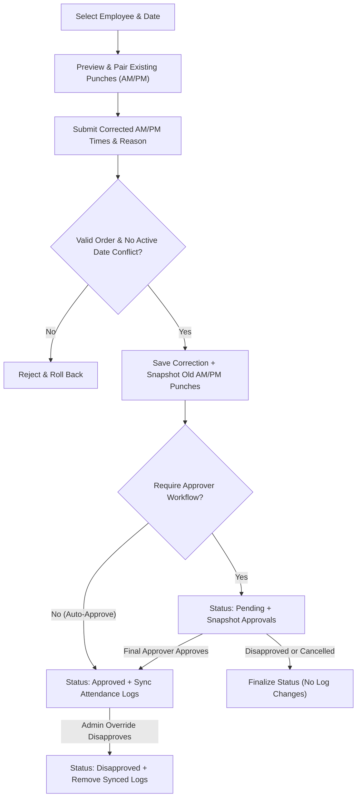
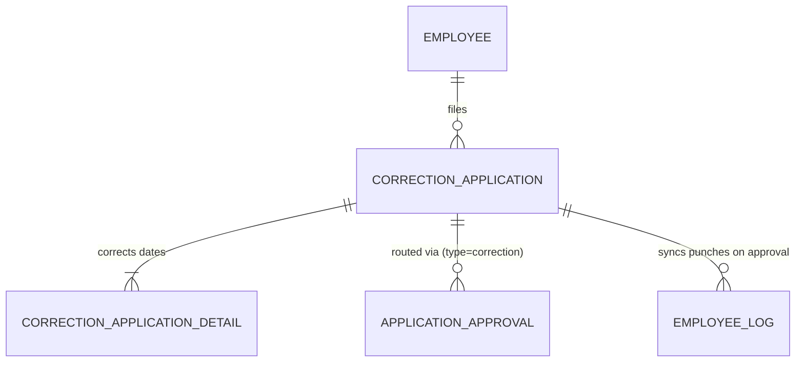

# Attendance Correction Applications

## 1. Purpose & Actors

The Attendance Correction Applications module ("Correction of Logs") allows employees and administrators to preview recorded daily attendance punches, propose corrected AM/PM punch times while capturing a before-and-after audit snapshot, route requests through sequential approval, and automatically synchronize approved corrections into raw attendance logs—directly updating Daily Time Record (DTR) computations.

### Actors

- **Employees:** Users with correction view, create, and update permissions. They preview their own recorded punches by date, submit single-employee correction requests for themselves, cancel their own pending requests, and approve or disapprove steps where they are the current sequence approver.
- **Administrators:** Users with administrative authority (system administrator role, user-management view, or approver-setup view). They view all correction applications, look up punches and proxy-file corrections for any single employee, optionally auto-approve on submission, and override-disapprove pending or approved corrections (triggering synced correction-log removal).

---

## 2. Process Flow

*Caption: Attendance correction preview, pre-change punch snapshotting, approval, and attendance-log synchronization/rollback flow.*

### Step-by-Step User & System Workflow

1. **Date Punch Preview & 4-Slot Heuristic Pairing:** When the user selects an employee and calendar date, the system fetches raw attendance punches for that date and pairs them into `am_in`, `am_out`, `pm_in`, and `pm_out` to pre-fill the form:
   - **0 punches:** All four slots empty.
   - **1 punch:** Before `12:00` -> `am_in`; `12:00` to `14:59:59` -> `pm_in`; `15:00` or later -> `pm_out`.
   - **2 punches:** Both morning (`first < 12:00` and `second <= 13:00`) -> `am_in, am_out`; `first < 12:00` and `second > 13:00` -> `am_in, pm_out`; `first >= 12:00` -> `pm_in, pm_out`.
   - **3 punches:** `first < 12:00` and `second <= 12:30` -> `am_in, am_out, pm_out`; `first < 12:00` and `second > 12:30` -> `am_in, pm_in, pm_out`; `first >= 12:00` -> `pm_in` (first) and `pm_out` (third).
   - **4 or more punches:** First -> `am_in`, second -> `am_out`, second-to-last -> `pm_in`, last -> `pm_out`.
2. **Submission & Pre-Change Snapshot:**
   - Inside an atomic transaction, the system locks the target employee record, validates unique dates within the request, ensures no existing `pending` or `approved` correction already covers any requested date, verifies at least one punch slot is populated per date, and validates chronological AM/PM order.
   - The system snapshots the current paired raw punches into `old_am_in`, `old_am_out`, `old_pm_in`, and `old_pm_out` alongside the requested new times.
   - If approver workflow is enabled, the application is saved as `pending` with snapshotted approval steps; raw attendance logs are **not** modified yet.
   - If auto-approve is selected, the application is saved as `approved` and immediately triggers attendance-log synchronization.
3. **Final Approval & Attendance-Log Synchronization:** When the final sequence approver approves (or on auto-approval), the system runs synchronization inside the same transaction:
   - Computes replaced timestamps (`old` timestamps not present in the `new` set) and deletes matching raw attendance log entries, **except** any log entry already linked to finalized attendance-log records.
   - Inserts each requested `new` timestamp not already present for that employee, tagged with source `correction` and a traceable device identifier (`CORRECTION-APP-<id>`).
4. **Admin Override Disapproval & Log Rollback:** If an administrator disapproves an already-`approved` correction, the status transitions to `disapproved` and the system deletes all raw attendance log entries created by that application (`source = correction`, matching `CORRECTION-APP-<id>`, and not linked to locked attendance records). Note that previously deleted `old` punches are not automatically re-inserted.
5. **Pending Disapproval & Applicant Cancellation:** Disapproving or cancelling a `pending` correction updates workflow statuses without modifying raw attendance logs and immediately frees those dates for re-filing.

---

## 3. Logical Data Schema

*Caption: Logical entities owned by Attendance Correction Applications and their synchronization link to raw employee logs.*

### Entity: Correction Application

| Field | Type | Required | Default | Constraints & Relationships | Purpose |
|---|---|---|---|---|---|
| `id` | `integer` | Yes | Auto-increment | Primary Key | Surrogate identifier for a correction application. |
| `employee_id` | `string(30)` | Yes | — | Foreign Key -> Employee (`Cascade`); Indexed with `status` | Single applicant employee identifier. |
| `reason` | `text` | Yes | — | Max 5,000 characters | Business explanation for the time-log correction. |
| `status` | `enum(pending, approved, disapproved, cancelled)` | Yes | `pending` | Indexed with `employee_id`; Server-controlled | Aggregate workflow status of the application. |
| `submitted_at` | `datetime` | Yes | Current timestamp | Server-controlled | Timestamp when the request was submitted. |
| `created_at` | `datetime` | No | — | — | Record creation timestamp. |
| `updated_at` | `datetime` | No | — | — | Record last-update timestamp. |

### Entity: Correction Application Detail

| Field | Type | Required | Default | Constraints & Relationships | Purpose |
|---|---|---|---|---|---|
| `id` | `integer` | Yes | Auto-increment | Primary Key | Surrogate identifier for a per-date correction row. |
| `correction_application_id` | `integer` | Yes | — | Foreign Key -> Correction Application (`Cascade`); Unique with `date` | Parent correction application. |
| `date` | `date` | Yes | — | Unique with `correction_application_id` | Calendar date being corrected. |
| `old_am_in` | `time` | No | — | Captured at submission | Pre-change snapshot of AM time-in. |
| `old_am_out` | `time` | No | — | Captured at submission | Pre-change snapshot of AM time-out. |
| `old_pm_in` | `time` | No | — | Captured at submission | Pre-change snapshot of PM time-in. |
| `old_pm_out` | `time` | No | — | Captured at submission | Pre-change snapshot of PM time-out. |
| `am_in` | `time` | No | — | At least one of `am_in..pm_out` required | Requested corrected AM time-in. |
| `am_out` | `time` | No | — | Must be later than `am_in` when both set | Requested corrected AM time-out. |
| `pm_in` | `time` | No | — | Must not precede latest AM punch | Requested corrected PM time-in. |
| `pm_out` | `time` | No | — | Must be later than `pm_in` when both set; must not precede latest AM punch | Requested corrected PM time-out. |
| `created_at` | `datetime` | No | — | — | Record creation timestamp. |
| `updated_at` | `datetime` | No | — | — | Record last-update timestamp. |

---

## 4. Business Rules & Invariants

1. **Single-Employee Only:** Multi-employee batch filing is prohibited; every correction application targets exactly one employee (even when filed by an administrator).
2. **Ownership on Preview & Filing:** Non-administrators may preview attendance logs and submit corrections only for their own employee record.
3. **Unique Dates Per Application:** Duplicate calendar dates within a single correction submission are rejected (and blocked by a unique constraint).
4. **One Active Correction Per Employee-Date:** An employee cannot submit a correction for a date that already appears in an existing `pending` or `approved` correction application. `disapproved` and `cancelled` applications free the date for re-filing.
5. **Non-Empty Punch Requirement:** At least one of the four requested punch slots (`am_in`, `am_out`, `pm_in`, `pm_out`) must be provided on every date row.
6. **Chronological AM/PM Ordering:** Within each date row, `am_out` must be later than `am_in`, `pm_out` must be later than `pm_in`, and the earliest PM punch must not be earlier than the latest AM punch.
7. **Immutable Pre-Change Snapshot:** Existing paired punches must be snapshotted into `old_am_in..old_pm_out` at submission time before any approval or log mutation occurs.
8. **Deferred Transactional Sync:** Pending applications must never alter raw attendance logs. Synchronization occurs atomically only upon final approval (or auto-approval).
9. **Attendance-Linked Log Protection:** Raw attendance logs already linked to finalized attendance records must never be deleted during sync or override-disapproval cleanup.
10. **Visibility Scoping:** Non-administrators see only their own applications or applications where they are a snapshotted approver; administrators see all records.

---

## 5. User Interface Capabilities

- **Correction Applications List Screen:**
  - Displays a paginated, sortable table with actionable checkboxes, applicant avatar/name/ID, corrected dates with compact `AM: in – out` and `PM: in – out` summary, reason, submission timestamp, status badge, and View/Approve/Disapprove/Cancel row actions.
  - Supports free-text search (across reason, employee ID, corrected dates, applicant name, and approver name), multi-select status filter, and submitted-date filter.
  - Gates the **Apply Correction** button behind create permission.
- **Floating Bulk Action Bar:** Provides batch **Approve**, **Disapprove**, and **Clear** controls across checked actionable rows with partial-failure handling.
- **Apply Correction Modal:**
  - Displays a single-employee selector and "Require approver workflow" checkbox for administrators, or a read-only current-employee banner for self-service users.
  - Renders dynamic per-date cards featuring a date picker, a live **Existing Logs** preview box (loading state, empty notice, or time-and-source badges), and clearable time pickers for `AM In`, `AM Out`, `PM In`, and `PM Out` auto-prefilled from the paired preview.
  - Includes a required reason text area and surfaces an actionable deep-link error hint to Approver Setup (pre-filtered to Correction) when an approver chain is missing.
- **Correction Detail View Modal:** Shows applicant identity, reason, a two-row-per-date comparison table displaying the muted **Old** punch snapshot directly above the highlighted **New** requested punches, the approval pipeline timeline, optional remarks input, and role-aware Approve/Disapprove/Cancel buttons.

---

## 6. Rebuild Notes

- **Enforce Admin-Only Auto-Approval Immediately:** The server currently allows any user with create permission to submit with auto-approval enabled, which directly overwrites raw attendance logs without review; the rebuild must strictly restrict auto-approval to administrators.
- **Lossless Rollback on Override Disapproval:** Currently, disapproving an approved correction deletes the synthesized correction punches without restoring the replaced `old` biometric/manual punches; consider soft-superseding original punches or restoring snapshotted punches on rollback.
- **Overnight & Multi-Punch (>4) Handling:** The current 4-slot calendar-day model cannot represent cross-midnight shift-out punches on a single date row and leaves middle punches (beyond 4) untouched; decide whether to support shift-anchored or overnight correction windows.
- **Payroll / Attendance Cutoff Locks:** Decide whether corrections targeting dates inside a closed payroll or attendance cutoff period should be blocked from submission or approval.
- **Live Attendance View Refresh & Attachments:** Ensure approval/disapproval invalidates cached attendance/DTR views, fix self-service applicant name display, and decide whether supporting attachments (such as incident memos) should be supported.
