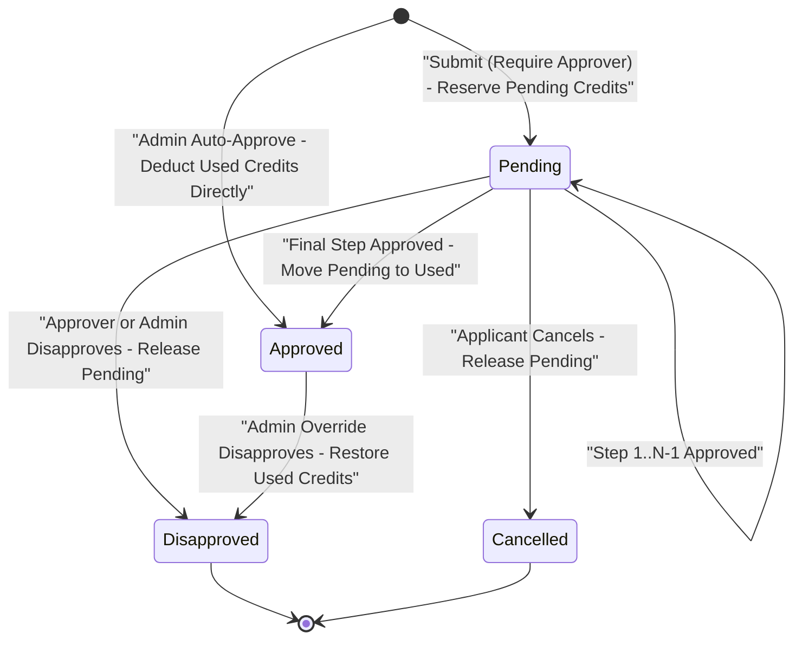
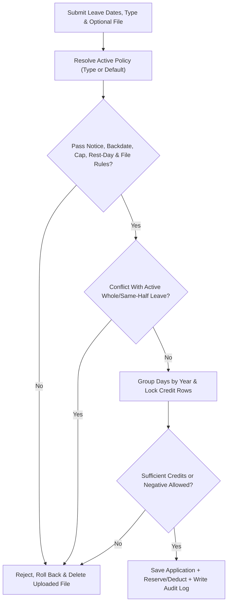
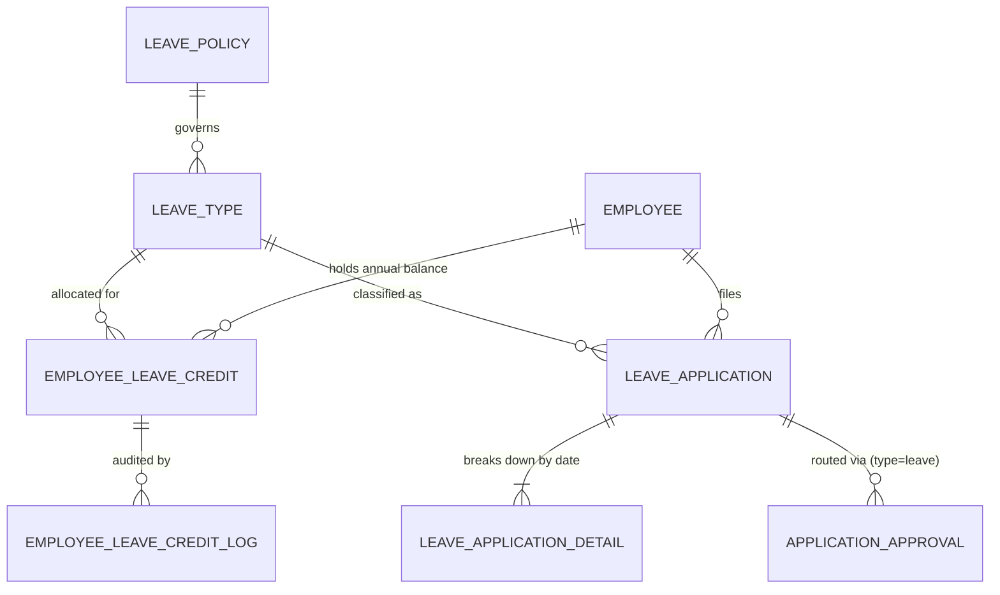

# Leave Management

## 1. Purpose & Actors

The Leave Management module governs organizational leave policies, leave type catalogs, annual per-employee leave credit ledgers with append-only audit trails, whole-day and half-day leave filing with private supporting attachments, and sequential multi-level approvals synchronized atomically with credit balances (`available = allocated - used - pending`).

### Actors

- **Employees:** Users with leave view, create, and update permissions. They monitor their own annual credit balances, file single-employee leave requests with optional or required supporting documents, view their own requests and requests assigned to them as approvers, cancel their own pending requests, and approve or disapprove steps on their turn.
- **Administrators:** Users with administrative authority (system administrator role, user-management view, approver-setup view, or leave delete permission). They manage Leave Policies, Leave Types, individual and bulk annual Leave Credit allocations, view credit audit ledgers, proxy-file and optionally auto-approve leave for any single employee, and override-disapprove pending or approved leave requests.

---

## 2. Process Flow

*Caption: Leave application lifecycle synchronized with annual credit ledger transitions (reserve, deduct, release, restore).*

*Caption: Leave policy evaluation, attachment validation, multi-year credit locking, and atomic submission flow.*

### Step-by-Step User & System Workflow

1. **Policy Resolution:** On submission, the system loads the selected active Leave Type and resolves its governing Leave Policy—using the type's linked policy if active, or falling back to the single active default policy.
2. **Policy & Date Rule Evaluation:** Against the resolved policy, the system validates each requested date row (`whole_day` = `1.00` day, `half_day_am` / `half_day_pm` = `0.50` day):
   - Enforces minimum advance-notice days, backdated filing permission and maximum backdated days, half-day eligibility, and maximum consecutive days cap.
   - When `count_rest_days` is disabled, rejects any date where the employee's active work schedule marks the day as a rest day.
   - Blocks duplicate dates in the same request, overlaps against existing `pending` or `approved` whole-day leaves, and same-half overlaps (`half_day_am` + `half_day_am`), while permitting complementary `half_day_am` + `half_day_pm` pairing across two separate requests on the same date.
3. **Attachment Handling:** If a file is uploaded, the system validates its format (`pdf`, `jpg`, `jpeg`, `png`, `doc`, `docx`, `xls`, `xlsx`) and size (up to 5 MB), rejects uploads when `allow_attachments` is false, requires an upload when both `allow_attachments` and `require_attachment` are true, and stores the file in private storage keyed to the employee. If the submission transaction later fails, the newly stored file is immediately deleted to prevent orphans.
4. **Multi-Year Credit Accounting & Ledger Logging:** For credit-bearing leave types (`requires_credits = true`), the system groups requested `day_value` totals by calendar year and pessimistically locks each year's employee leave credit row:
   - Verifies `available_credits >= requested_days` unless `allow_negative_balance` is enabled (which also auto-creates a zero-allocated credit row if none exists for that year).
   - **Pending Submission (`allow_approver = true`):** Increments `pending_credits`, records a `reserve` ledger entry, and snapshots the employee's `leave` approver chain.
   - **Admin Auto-Approve (`allow_approver = false`):** Increments `used_credits` directly, records a `deduct` ledger entry, and saves the application as `approved`.
5. **Approval, Disapproval, Cancellation & Override:**
   - **Final Approval:** Moves reserved days from `pending_credits` to `used_credits` and appends a `deduct` ledger entry.
   - **Pending Disapproval or Applicant Cancellation:** Decrements `pending_credits` and appends a `release` ledger entry.
   - **Admin Disapproval Override (on Approved Leave):** Decrements `used_credits` and appends a `restore` ledger entry.
   - Every ledger entry records `change_type`, `amount`, resulting `balance_after`, `leave_application_id`, `remarks`, and `acted_by`.

---

## 3. Logical Data Schema

*Caption: Logical data model for Leave Policies, Leave Types, Annual Credits, Credit Audit Logs, and Leave Applications.*

### Entity: Leave Policy

| Field | Type | Required | Default | Constraints & Relationships | Purpose |
|---|---|---|---|---|---|
| `id` | `integer` | Yes | Auto-increment | Primary Key | Surrogate identifier for a leave policy. |
| `name` | `string(100)` | Yes | — | Unique | Distinct policy name. |
| `description` | `string(255)` | No | — | — | Optional policy summary. |
| `min_notice_days` | `integer` | Yes | `0` | Unsigned | Minimum advance-notice days before leave start. |
| `allow_backdated_filing` | `boolean` | Yes | `false` | — | Permits filing for past dates. |
| `max_backdated_days` | `integer` | No | — | Unsigned | Max past days allowed when backdating is enabled. |
| `max_consecutive_days` | `integer` | No | — | Unsigned | Optional cap on consecutive leave days per request. |
| `allow_half_day` | `boolean` | Yes | `true` | — | Permits AM/PM half-day requests. |
| `accrual_mode` | `enum(upfront_annual, monthly_accrual, none)` | Yes | `upfront_annual` | — | Accrual strategy metadata. |
| `allow_negative_balance` | `boolean` | Yes | `false` | — | Permits filing beyond available credits. |
| `carry_over_enabled` | `boolean` | Yes | `false` | — | Year-end carry-over eligibility metadata. |
| `carry_over_max_days` | `decimal(6,2)` | Yes | `0.00` | — | Maximum days eligible for carry-over. |
| `count_rest_days` | `boolean` | Yes | `false` | — | Whether scheduled rest days count toward leave days. |
| `allow_attachments` | `boolean` | Yes | `false` | — | Enables supporting document uploads. |
| `require_attachment` | `boolean` | Yes | `false` | — | Makes supporting document mandatory when uploads are enabled. |
| `is_default` | `boolean` | Yes | `false` | Indexed with `is_active`; Only one active default | Fallback policy for leave types without an explicit policy. |
| `is_active` | `boolean` | Yes | `true` | Indexed with `is_default` | Indicates whether the policy is active. |

### Entity: Leave Type

| Field | Type | Required | Default | Constraints & Relationships | Purpose |
|---|---|---|---|---|---|
| `id` | `integer` | Yes | Auto-increment | Primary Key | Surrogate identifier for a leave type. |
| `code` | `string(20)` | Yes | — | Unique | Short leave code (e.g., VL, SL, EL, LWOP). |
| `name` | `string(100)` | Yes | — | — | Human-readable leave type name. |
| `description` | `string(255)` | No | — | — | Optional description. |
| `leave_policy_id` | `integer` | No | — | Foreign Key -> Leave Policy (`Set Null`) | Linked policy; falls back to default policy when empty. |
| `is_paid` | `boolean` | Yes | `true` | — | Indicates whether this leave type is paid. |
| `requires_credits` | `boolean` | Yes | `true` | — | Enforces credit balance checks and ledger updates. |
| `default_credits` | `decimal(6,2)` | Yes | `0.00` | — | Default annual credit allocation in days for bulk setup. |
| `is_active` | `boolean` | Yes | `true` | Indexed | Controls whether employees can file this leave type. |

### Entity: Employee Leave Credit

| Field | Type | Required | Default | Constraints & Relationships | Purpose |
|---|---|---|---|---|---|
| `id` | `integer` | Yes | Auto-increment | Primary Key | Surrogate identifier for an annual credit balance. |
| `employee_id` | `string(30)` | Yes | — | Foreign Key -> Employee (`Cascade`); Unique with `(leave_type_id, year)`; Indexed with `year` | Employee holding the entitlement. |
| `leave_type_id` | `integer` | Yes | — | Foreign Key -> Leave Type (`Cascade`); Unique with `(employee_id, year)` | Leave type being tracked. |
| `year` | `integer` | Yes | — | Unsigned; Unique with `(employee_id, leave_type_id)` | Calendar entitlement year. |
| `allocated_credits` | `decimal(6,2)` | Yes | `0.00` | Must be >= `used_credits + pending_credits` | Total credits granted for the year. |
| `used_credits` | `decimal(6,2)` | Yes | `0.00` | — | Credits consumed by approved applications. |
| `pending_credits` | `decimal(6,2)` | Yes | `0.00` | — | Credits reserved by pending applications. |

### Entity: Employee Leave Credit Log (Append-Only)

| Field | Type | Required | Default | Constraints & Relationships | Purpose |
|---|---|---|---|---|---|
| `id` | `integer` | Yes | Auto-increment | Primary Key | Surrogate identifier for a ledger entry. |
| `employee_leave_credit_id` | `integer` | Yes | — | Foreign Key -> Employee Leave Credit (`Cascade`) | Parent annual credit balance row. |
| `change_type` | `enum(grant, adjustment, reserve, deduct, release, restore)` | Yes | — | — | Classification of the balance mutation. |
| `amount` | `decimal(6,2)` | Yes | — | — | Credit delta in days for the event. |
| `balance_after` | `decimal(6,2)` | Yes | — | — | Remaining available balance after applying the mutation. |
| `leave_application_id` | `integer` | No | — | Indexed; Logical ref -> Leave Application (no DB FK) | Originating application for workflow mutations. |
| `remarks` | `string(255)` | No | — | — | Audit reason or note. |
| `acted_by` | `string(30)` | No | — | Logical ref -> Employee (no DB FK) | Employee who triggered the balance change. |
| `created_at` | `datetime` | Yes | Current timestamp | Immutable (no `updated_at`) | Timestamp when the ledger entry was recorded. |

### Entity: Leave Application

| Field | Type | Required | Default | Constraints & Relationships | Purpose |
|---|---|---|---|---|---|
| `id` | `integer` | Yes | Auto-increment | Primary Key | Surrogate identifier for a leave application. |
| `employee_id` | `string(30)` | Yes | — | Foreign Key -> Employee (`Cascade`); Indexed with `status` | Single applicant employee identifier. |
| `leave_type_id` | `integer` | Yes | — | Foreign Key -> Leave Type (`Restrict`) | Requested leave type. |
| `date_from` | `date` | Yes | — | — | Inclusive start date of the leave span. |
| `date_to` | `date` | Yes | — | — | Inclusive end date of the leave span. |
| `total_days` | `decimal(6,2)` | Yes | — | Sum of child `day_value` rows | Total leave days requested. |
| `reason` | `text` | Yes | — | — | Applicant's stated reason for leave. |
| `attachment_path` | `string(255)` | No | — | Private storage relative path | Stored path of the supporting document. |
| `attachment_name` | `string(255)` | No | — | — | Original filename of the supporting document. |
| `status` | `enum(pending, approved, disapproved, cancelled)` | Yes | `pending` | Indexed with `employee_id`; Server-controlled | Aggregate workflow status. |
| `submitted_at` | `datetime` | Yes | Current timestamp | Server-controlled | Submission timestamp. |

### Entity: Leave Application Detail

| Field | Type | Required | Default | Constraints & Relationships | Purpose |
|---|---|---|---|---|---|
| `id` | `integer` | Yes | Auto-increment | Primary Key | Surrogate identifier for a per-date leave row. |
| `leave_application_id` | `integer` | Yes | — | Foreign Key -> Leave Application (`Cascade`); Unique with `date` | Parent leave application. |
| `date` | `date` | Yes | — | Unique with `leave_application_id` | Calendar date covered by this detail row. |
| `duration_type` | `enum(whole_day, half_day_am, half_day_pm)` | Yes | `whole_day` | — | Portion of the day requested. |
| `day_value` | `decimal(4,2)` | Yes | `1.00` | `1.00` for whole day; `0.50` for half day | Numeric credit equivalent for this date. |

---

## 4. Business Rules & Invariants

1. **Single-Employee Filing & Admin-Only Auto-Approval:** Multi-employee filing is prohibited. Non-administrators may file only for themselves and are always forced into the approver workflow (`allow_approver = true`).
2. **Active Type & Default Policy Fallback:** Filing against an inactive leave type is rejected. Policy evaluation uses the leave type's active linked policy or falls back to the single active default policy; deactivating the default policy is blocked.
3. **Policy Rule Enforcement:** Notice days, backdating eligibility/limits, max consecutive days, half-day eligibility, and rest-day exclusion are enforced strictly from the resolved policy.
4. **Half-Day Pairing vs Conflict:** Duplicate dates in one request, whole-day overlaps, and same-half overlaps against `pending`/`approved` leaves are rejected; complementary `half_day_am` and `half_day_pm` requests on the same date are allowed.
5. **Private Attachment Governance:** Uploads are restricted to permitted document/image formats up to 5 MB, enforced against `allow_attachments` and `require_attachment`, cleaned up on transaction failure, and downloadable only by users authorized to view the application (applicant, snapshotted approver, or administrator).
6. **Transactional Credit Accounting:** Credit checks and updates lock affected annual credit rows per calendar year, enforce `available_credits >= requested_days` unless negative balances are allowed, and write an immutable audit log for every balance mutation.
7. **Allocation Floor & Delete Protection:** Manual credit updates cannot lower `allocated_credits` below `used_credits + pending_credits`. A Leave Policy cannot be deleted while assigned to any Leave Type, and a Leave Type cannot be deleted while referenced by any leave credits or applications.
8. **Admin-Only Configuration:** Access to Leave Policies, Leave Types, bulk annual credit allocation, and other employees' credit balances is restricted to administrators.

---

## 5. User Interface Capabilities

- **Three-Tab Unified Workspace:**
  - **Leave Applications Tab (All Permitted Users):**
    - **Balance Utilization Strip:** Displays the signed-in employee's current-year credit utilization bars (`allocated`, `used`, `pending`, `available`) for credit-bearing leave types.
    - **Applications Table & Bulk Action Bar:** Paginated, searchable, sortable table with status, leave-type, and date-range filters, row-level View/Approve/Disapprove/Cancel actions, and a floating bulk approve/disapprove bar.
    - **Apply Leave Modal:** Single-employee selector (admin) or read-only applicant banner (self-service), leave-type picker, per-date duration rows (`Whole Day`, `Half Day AM`, `Half Day PM`), reason input, policy-aware file attachment picker, and admin-only auto-approve toggle.
    - **Leave View Modal:** Displays leave summary, per-date breakdown, private attachment download button, approval timeline with remarks, and role-aware Approve/Disapprove/Cancel actions.
  - **Leave Setup Tab (Admin Only, Deep-Linkable):** Manages Leave Types CRUD, individual employee credit table and upsert/edit modals, bulk annual credit allocation across employees, and a per-credit audit ledger drawer/modal.
  - **Leave Policies Tab (Admin Only, Deep-Linkable):** Manages reusable Leave Policy CRUD including notice, backdating, consecutive caps, half-day, rest-day, negative-balance, attachment, accrual/carry-over, and default-policy controls.
- **Actionable Error Hints:** Submission failures surface direct deep-links to Approver Setup (missing leave approver chain) and to the Leave Setup or Policies tabs (missing or insufficient credits).

---

## 6. Rebuild Notes

- **Automated Accrual & Year-End Carry-Over Jobs:** `accrual_mode`, `carry_over_enabled`, and `carry_over_max_days` are currently stored as informational metadata only; decide whether to implement scheduled monthly accrual and year-end carry-over batch jobs that write `grant`/`carry_over` credit logs.
- **DTR & Payroll Integration:** Approved leaves are not yet consumed by Daily Time Record (DTR) evaluation or payroll; define how approved paid vs unpaid (`is_paid`) whole-day and half-day leaves credit attendance hours and suppress absence/undertime deductions.
- **Dedicated Admin Menu Permissions:** Decide whether Leave Setup and Leave Policies should remain gated under the single leave-application menu plus administrator role checks or be split into separate granular permissions.
- **Self-Service Applicant Identity Display:** Ensure the filing modal displays the signed-in employee's full name consistently rather than relying on unpopulated user fields.
