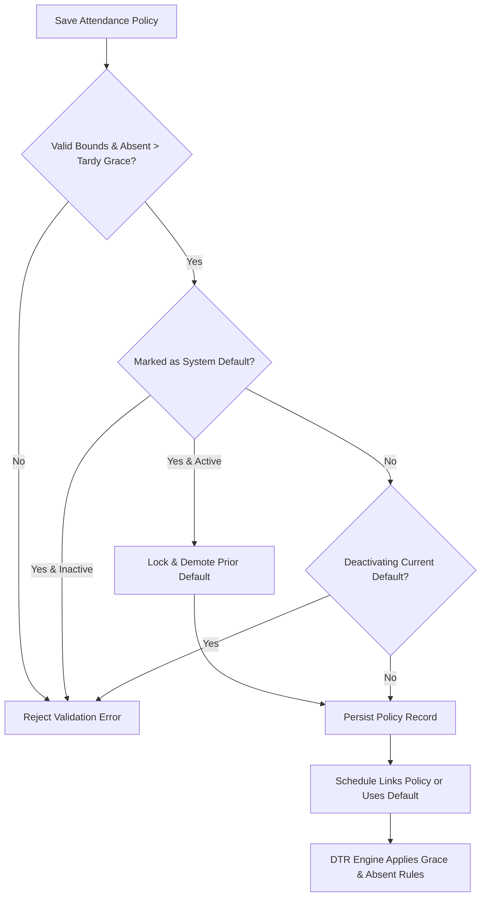

# Attendance Policies

## 1. Purpose & Actors

Attendance Policies centralize reusable attendance evaluation rules—tardy grace periods, tardy accrual modes, late-to-absent cutoffs, undertime grace periods, and biometric punch-window tolerances—as named master records. Policies are attached to work schedule templates or designated as the single active system-default fallback used during Daily Time Record (DTR) evaluation.

- **Administrator / HR Policy Manager:** Creates, views, updates, promotes the system default, activates or deactivates, and deletes unused attendance policies.
- **Schedule Manager:** Selects an active attendance policy (or relies on the system default) when configuring a work schedule template.
- **Timekeeping / DTR Engine (System):** Resolves the effective policy for each evaluated schedule and applies grace and absence thresholds to daily punches.

---

## 2. Process Flow

*Caption: Attendance policy lifecycle, single-default promotion guard, and runtime DTR resolution.*

### Step-by-Step Workflow

1. **Create Policy:** The administrator enters a unique policy name, optional description, tardy grace period, tardy counting mode, optional late-to-absent threshold, undertime grace period, biometric tap-window settings, and default/active flags. The system normalizes omitted tap-window values to their defaults (`14400`, `14400`, `120` seconds), validates all numeric bounds and cross-field rules, transactionally locks and demotes any existing default when the new policy is marked default, and saves the record.
2. **Update Policy:** The system locks the target policy record, merges any partial changes with existing stored values, and re-validates all bounds and cross-field invariants (preventing partial updates from violating `absent_after_late_seconds > tardy_grace_seconds`). If the update attempts to deactivate the current system default without promoting another default, it is rejected. If the policy is promoted to default, all other defaults are atomically demoted before saving.
3. **Delete Policy:** The system locks the policy record and checks whether any work schedule template references it or whether it is currently the system default. If either condition is true, deletion is rejected; otherwise, the record is permanently removed.
4. **Runtime DTR Resolution:** When evaluating a working shift slot, the DTR engine checks for explicit slot-level cutoff overrides (`tardy_start`, `undertime_start`) first. If none are set, it loads the attendance policy linked to the schedule template. If no policy is linked, it falls back to the active system-default policy. If no active default exists, it evaluates with zero grace and no late-to-absent threshold.

### Evaluation Behavior Examples

- **Grace Window:** With a 15-minute (`900` seconds) tardy grace on an 08:00 shift, punching in at 08:10 produces `0` tardy seconds.
- **Schedule Start vs After Grace:** Punching in at 08:20 on the same 08:00 shift yields `1200` tardy seconds under `schedule_start` (full 20 minutes from 08:00) versus `300` tardy seconds under `after_grace` (5 minutes past the 08:15 cutoff).
- **Late-to-Absent Threshold:** With `absent_after_late_seconds` set to 60 minutes (`3600` seconds), punching in at 09:05 on an 08:00–12:00 shift marks the slot absent with `0` rendered seconds and full scheduled undertime.
- **Undertime Grace:** With a 10-minute (`600` seconds) undertime grace on a shift ending at 17:00, punching out at 16:55 yields `0` undertime seconds, whereas punching out at 16:40 yields `1200` undertime seconds (20 minutes short of 17:00).

---

## 3. Logical Data Schema

### Attendance Policy (`attendance_policies`)

| Field | Type | Required | Default | Constraints & Relationships | Purpose |
|---|---|---|---|---|---|
| `id` | `integer` | Yes | Auto-increment | PK | Surrogate policy identifier |
| `name` | `string(100)` | Yes | — | Unique | Human-readable policy name |
| `description` | `string(255)` | No | Null | — | Optional summary of policy intent |
| `tardy_grace_seconds` | `integer` | Yes | `0` | Range `0..43200` | Allowed grace period in seconds after shift start before tardiness applies |
| `tardy_count_from` | `enum(schedule_start, after_grace)` | Yes | `schedule_start` | — | Origin from which tardiness duration accrues once grace is exceeded |
| `absent_after_late_seconds` | `integer` | No | Null | Nullable; range `60..86400`; strictly greater than `tardy_grace_seconds` | Optional lateness threshold beyond which the shift is marked absent |
| `undertime_grace_seconds` | `integer` | Yes | `0` | Range `0..43200` | Allowed grace period in seconds before shift end without incurring undertime |
| `early_in_window_seconds` | `integer` | Yes | `14400` | Range `0..43200` | Maximum seconds before shift start to accept an early punch (4 hours default) |
| `late_out_window_seconds` | `integer` | Yes | `14400` | Range `0..43200` | Maximum seconds after shift end to accept a late punch (4 hours default) |
| `duplicate_tap_window_seconds` | `integer` | Yes | `120` | Range `0..3600` | Debounce window in seconds for ignoring repeated biometric taps |
| `is_default` | `boolean` | Yes | `false` | Indexed with `is_active`; at most one `true` system-wide | Designates the fallback policy for schedules with no linked policy |
| `is_active` | `boolean` | Yes | `true` | Indexed with `is_default` | Controls whether the policy is selectable for new schedule templates |
| `created_at` | `datetime` | No | Null | — | Record creation timestamp |
| `updated_at` | `datetime` | No | Null | — | Record last-update timestamp |

*Outbound Relationship:* Referenced optionally by `schedules.attendance_policy_id` (`Set Null` at the storage layer; deletion is blocked by application rules while any schedule references the policy).

*Lifecycle Semantics:* Policies use hard deletion only when unreferenced and non-default (no soft-delete archive column). Policies that are already linked to schedules can be deactivated (`is_active = false`) to prevent new assignments while retaining their rules for currently linked schedules.

*Indexes:* Unique index on `name`; composite index on `(is_active, is_default)` for fast active system-default resolution.

---

## 4. Business Rules & Invariants

| # | Rule | Enforcement Requirement |
|---|---|---|
| 1 | **Integer-Seconds Storage Unit** | All grace periods, thresholds, and tap windows are stored and validated as non-negative integer seconds. User interfaces convert minutes to and from integer seconds cleanly. |
| 2 | **Unique Policy Name** | `name` is required, up to 100 characters, and unique across all attendance policies (excluding the current policy on update). |
| 3 | **Duration Bounds** | `tardy_grace_seconds`, `undertime_grace_seconds`, `early_in_window_seconds`, and `late_out_window_seconds` must be within `0..43200` (0–12 hours). `absent_after_late_seconds` must be null or `60..86400` (1 min–24 hours). `duplicate_tap_window_seconds` must be within `0..3600` (0–60 min). |
| 4 | **Tardy Counting Mode** | `tardy_count_from` must be `schedule_start` (count full lateness from shift start once grace is exceeded) or `after_grace` (count only seconds past the grace cutoff). |
| 5 | **Absent Threshold Exceeds Tardy Grace** | Whenever `absent_after_late_seconds` is non-null, it must be strictly greater than the effective `tardy_grace_seconds`. Partial updates must validate against the merged policy state. |
| 6 | **Single Active System Default** | At most one policy may have `is_default = true`, and a default policy must always have `is_active = true`. Promoting a policy to default must atomically demote all other defaults under a transactional lock. |
| 7 | **Default Deactivation Guard** | Updating the current default policy to `is_active = false` is rejected until another active policy is promoted as default. |
| 8 | **Usage & Default Deletion Guard** | Deleting a policy is rejected if any work schedule template references it or if `is_default = true`. Unreferenced non-default policies are hard-deleted. |
| 9 | **Policy Resolution Precedence** | DTR evaluation applies: (1) explicit shift-slot cutoff times (`tardy_start`, `undertime_start`), (2) schedule-linked policy (honored even if later deactivated while still linked), (3) active system-default policy, (4) zero grace and disabled late-to-absent cutoff. |

---

## 5. User Interface Capabilities

### Attendance Policy List Screen
- **Table Columns:** `Actions` (View, Edit, Delete), `Policy` (name, `Default` badge when system default, single-line clamped description), `Tardy grace` (formatted hours and minutes), `Count tardy from` badge (`Schedule start` or `After grace`), `Absent after late` (duration or `Disabled`), `Undertime grace`, and `Status` badge (`Active` or `Inactive`).
- **Search, Filtering & Sorting:** Free-text search across name and description; dropdown filters for count mode, default status, and active status; creation date range filter; server-side sorting across policy attributes (default newest first) and pagination (1–100 rows per page).
- **Permission-Gated Actions:** Viewing the screen requires policy-view access; `New policy` requires create access; `Edit` requires update access; `Delete` requires delete access.

### Create / Edit / View Modal & Delete Dialog
- **Section 1 — Policy Details:** Policy name (required, max 100 chars), description (optional, max 255 chars), `System default policy` checkbox (checking automatically enables and locks the `Active policy` checkbox), and `Active policy` checkbox.
- **Section 2 — Tardy, Absent & Undertime Rules:** Tardy grace period in minutes (`0..720`, default `15`), `Count tardy from` selector with live explanatory hint, optional `Mark absent after late` in minutes (`1..1440`; blank disables), and undertime grace period in minutes (`0..720`, default `0`). All minute inputs convert automatically to integer seconds on submission and back to minutes when loading.
- **Section 3 — Biometric Log Windows:** Early-in window in minutes (`0..720`, default `240`), late-out window in minutes (`0..720`, default `240`), and duplicate tap window in seconds (`0..3600`, default `120`).
- **View Mode & Feedback States:** Opening in View mode disables all inputs and displays only a Close action. Delete confirmation surfaces server rejection messages inline when a policy is default or linked to schedules. Standard loading, retry-on-error, field-level validation error, and empty-list states are supported.
- **Cross-Screen Cache & Selection Behavior:** Saving or deleting a policy refreshes both the Attendance Policies list and Schedule Management policy dropdowns. Only active policies appear as selectable options when creating new schedule templates, alongside the `System default policy` option.

### Access Control Summary
- **Administrator / Policy Manager:** Granted full view, create, update, and delete permissions on Attendance Policies.
- **Schedule Manager:** Requires policy-view permission to populate the policy selector on schedule templates.
- **Standard Employee:** Has no access to view or manage Attendance Policies directly.

---

## 6. Rebuild Notes

- **Biometric Tap-Window Enforcement:** Decide whether `early_in_window_seconds`, `late_out_window_seconds`, and `duplicate_tap_window_seconds` should be actively enforced during punch pairing and DTR calculation, or clearly marked as deferred/hidden until biometric log filtering consumes them.
- **Retroactive Policy Edits vs Historical Snapshots:** Editing an active policy currently affects past dates when DTR is computed on the fly. Decide whether confirmed DTR records should snapshot effective policy thresholds so historical payroll periods remain immutable.
- **Deactivated Linked Policies:** Currently, deactivating a non-default policy hides it from new schedule selections while schedules already linked to it continue using it. Confirm whether this behavior is desired or whether deactivation should require reassigning linked schedules first.
- **Audit Attribution:** Consider adding `created_by` and `updated_by` user references (or a policy revision log) to support HR compliance audits.
