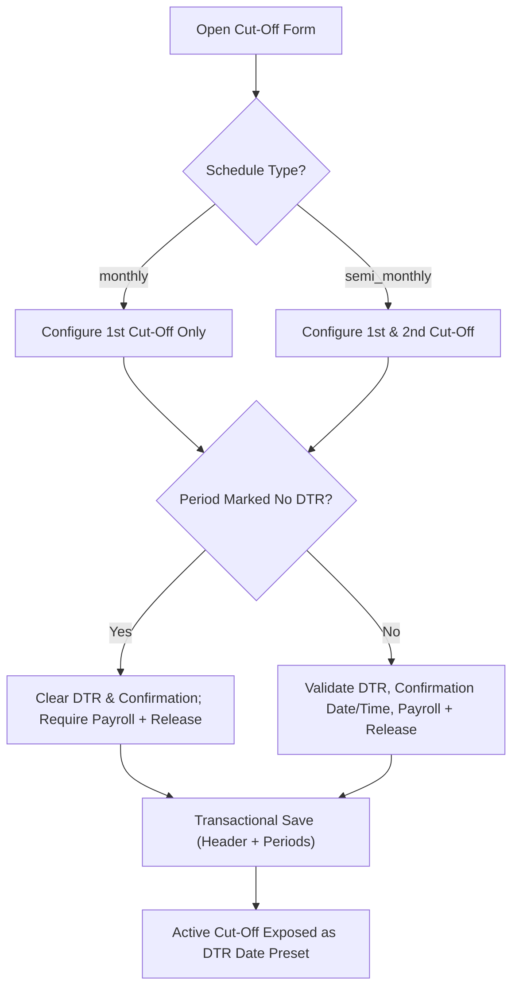
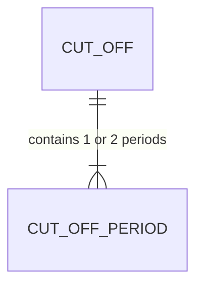

# Cut-Off Management

## 1. Purpose & Actors

Cut-Off Management defines monthly (1 period) and semi-monthly (2 periods) DTR coverage, DTR confirmation windows, payroll coverage, and salary release calendars in a normalized parent-child master schedule. It organizes recurring timekeeping and payroll cycles and supplies date-range presets to the Attendance module.

- **Administrator / HR Payroll Coordinator:** Creates, views, updates, activates or deactivates, and deletes cut-off calendar definitions and their nested periods.
- **Attendance Viewer:** Consumes active cut-off definitions on the Attendance screen to auto-fill DTR `From` and `To` date-range presets.
- **Downstream Timekeeping & Payroll Processes (Planned System Actor):** Intended future consumers of DTR confirmation windows, payroll-only flags, payroll date ranges, and release dates.

---

## 2. Process Flow

*Caption: Monthly vs semi-monthly cut-off configuration, `no_dtr` normalization, and DTR preset consumption flow.*

### Step-by-Step Workflow

1. **Create Cut-Off:** The administrator enters a descriptive name, schedule type (`monthly` or `semi_monthly`), calendar year, calendar month, active status, and configures 1 period (for `monthly`) or 2 periods (for `semi_monthly`). The system verifies exact period numbering (`[1]` vs `[1, 2]`), enforces date ordering and combined confirmation datetime ordering, clears all 6 DTR and confirmation fields to null whenever `no_dtr = true`, normalizes confirmation times, and persists the parent header and child periods atomically.
2. **Update Cut-Off:** The system locks the parent cut-off record inside a transaction, validates and normalizes the replacement period definitions, updates the parent header, removes prior child period rows, and inserts the replacement periods. Any validation or storage error rolls back the entire transaction.
3. **Delete Cut-Off:** The system locks and permanently deletes the parent cut-off header, cascading deletion to all child period rows.
4. **DTR Preset Consumption:** When a user opens the Attendance screen, the interface loads active cut-offs matching the chosen schedule type and populates the DTR `From` and `To` dates using `dtr_date_from` and `dtr_date_to` (falling back to `payroll_date_from` and `payroll_date_to` when `no_dtr = true`).

---

## 3. Logical Data Schema

*Caption: Parent cut-off header to child cut-off period relationship.*

### Cut-Off (`cut_offs`)

| Field | Type | Required | Default | Constraints & Relationships | Purpose |
|---|---|---|---|---|---|
| `id` | `integer` | Yes | Auto-increment | PK | Surrogate cut-off header identifier |
| `schedule_type` | `enum(monthly, semi_monthly)` | Yes | — | Indexed with (`year`, `month`) | Cut-off cadence (`monthly` = 1 period; `semi_monthly` = 2 periods) |
| `name` | `string(100)` | Yes | — | — | Descriptive label (e.g., October 2026 Semi-Monthly) |
| `year` | `integer` | Yes | — | Range `1900..9999`; Indexed with (`month`, `schedule_type`) | Calendar year of the cut-off |
| `month` | `integer` | Yes | — | Range `1..12`; Indexed with (`year`, `schedule_type`) | Calendar month of the cut-off |
| `is_active` | `boolean` | Yes | `true` | Indexed | Controls whether the cut-off is active for selection and presets |
| `created_at` | `datetime` | No | Null | — | Record creation timestamp |
| `updated_at` | `datetime` | No | Null | — | Record last-update timestamp |

### Cut-Off Period (`cut_off_periods`)

| Field | Type | Required | Default | Constraints & Relationships | Purpose |
|---|---|---|---|---|---|
| `id` | `integer` | Yes | Auto-increment | PK | Surrogate cut-off period identifier |
| `cut_off_id` | `integer` | Yes | — | FK -> `cut_offs.id` (`Cascade`); Unique with `cut_off_no` | Parent cut-off header |
| `cut_off_no` | `integer` | Yes | — | `1` (monthly) or `1`, `2` (semi-monthly); Unique with `cut_off_id` | Period sequence number within the cut-off |
| `dtr_date_from` | `date` | No | Null | Indexed with `dtr_date_to`; Required when `no_dtr = false` | Inclusive start date of DTR coverage |
| `dtr_date_to` | `date` | No | Null | Indexed with `dtr_date_from`; `>= dtr_date_from` when `no_dtr = false` | Inclusive end date of DTR coverage |
| `no_dtr` | `boolean` | Yes | `false` | — | Marks a payroll-only period without DTR collection or confirmation |
| `confirmation_start_date` | `date` | No | Null | Required when `no_dtr = false` | Start date of the DTR confirmation window |
| `confirmation_end_date` | `date` | No | Null | `>= confirmation_start_date` when `no_dtr = false` | End date of the DTR confirmation window |
| `confirmation_time_from` | `time` | No | Null | Required when `no_dtr = false` | Opening time of day for DTR confirmation |
| `confirmation_time_to` | `time` | No | Null | Combined end datetime `>=` start datetime when `no_dtr = false` | Closing time of day for DTR confirmation |
| `payroll_date_from` | `date` | Yes | — | Indexed with `payroll_date_to` | Inclusive start date of payroll coverage |
| `payroll_date_to` | `date` | Yes | — | Indexed with `payroll_date_from`; `>= payroll_date_from` | Inclusive end date of payroll coverage |
| `release_date` | `date` | Yes | — | Indexed; `>= payroll_date_to` | Scheduled salary payout / release date |
| `created_at` | `datetime` | No | Null | — | Record creation timestamp |
| `updated_at` | `datetime` | No | Null | — | Record last-update timestamp |

---

## 4. Business Rules & Invariants

| # | Rule | Enforcement Requirement |
|---|---|---|
| 1 | **Valid Cadence & Calendar Metadata** | `schedule_type` must be `monthly` or `semi_monthly`; `name` is required (max 100 chars); `year` must be `1900..9999`; `month` must be `1..12`. |
| 2 | **Exact Period Cardinality & Numbering** | `monthly` requires exactly one period (`cut_off_no = 1`); `semi_monthly` requires exactly two distinct periods (`cut_off_no = 1` and `2`). Any mismatch or duplicate period number is rejected. |
| 3 | **Payroll-Only (`no_dtr = true`) Clearing** | When `no_dtr = true`, all 6 DTR and confirmation fields (`dtr_date_from`, `dtr_date_to`, `confirmation_start_date`, `confirmation_end_date`, `confirmation_time_from`, `confirmation_time_to`) are excluded from required validation and forcibly cleared to null before saving; payroll dates and `release_date` remain required. |
| 4 | **DTR & Confirmation Requirement (`no_dtr = false`)** | When `no_dtr = false`, all 6 DTR and confirmation fields are required, with `dtr_date_to >= dtr_date_from` and `confirmation_end_date >= confirmation_start_date`. |
| 5 | **Combined Confirmation Datetime Ordering** | When `no_dtr = false`, the combined confirmation end timestamp (`confirmation_end_date` + `confirmation_time_to`) must be on or after the combined start timestamp (`confirmation_start_date` + `confirmation_time_from`). |
| 6 | **Independent Cross-Month Payroll & Release Ordering** | Every period requires `payroll_date_to >= payroll_date_from` and `release_date >= payroll_date_to`. DTR and payroll ranges are independent and may span across calendar month boundaries. |
| 7 | **Strict Period Field Allowlist** | Unknown or server-controlled attributes (such as period IDs or parent references) inside submitted period items are rejected. |
| 8 | **Atomic Parent-Child Persistence** | Creating, updating (with row lock on parent), and deleting a cut-off and its periods must execute atomically inside a single transaction. |
| 9 | **Multiple Cut-Offs Per Month Allowed** | Multiple cut-off headers for the same `(year, month, schedule_type)` and overlapping date ranges are permitted to support distinct payroll groups. |

---

## 5. User Interface Capabilities

### Cut-Off List Screen
- **Table Columns:** `Name` (label plus Month and Year subtitle), `Schedule` badge (`Monthly` or `Semi-Monthly`), `DTR period` (per-period date range or `No DTR`), `Payroll period` (per-period date range), `Release date` (per-period formatted date), `Status` badge (`Active` or `Inactive`), and `Actions` (View, Edit, Delete).
- **Search, Filtering & Sorting:** Free-text search by name; dropdown filters for schedule type, month (`1..12`), and active status; creation date range filter; server-side sorting across header columns (default newest first) and pagination (1–100 rows per page).
- **Permission-Gated Actions:** Viewing requires cut-off view access; `New cut-off`, `Edit`, and `Delete` are gated by create, update, and delete permissions respectively.

### Create / Edit / View Modal & Delete Dialog
- **Configuration Section:** Name (required, max 100 chars; new drafts default to current month and year), schedule type (`monthly` or `semi_monthly`), month (`1..12`), year (`1900..9999`), and `Active cut-off` checkbox (default checked). Toggling between monthly and semi-monthly preserves unsaved second-period draft inputs in UI state.
- **Period Cards (`1st Cut-Off`, plus `2nd Cut-Off` for `semi_monthly`):**
  - **DTR Cut-Off:** `No DTR` checkbox (disables DTR and confirmation inputs without discarding draft values), `DTR from`, and `DTR to` (minimum constrained to `DTR from`).
  - **DTR Confirmation:** `Start date`, `End date` (minimum `Start date`), `From time`, and `To time` (minimum `From time` when start and end dates match).
  - **Payroll Cut-Off:** `Payroll from`, `Payroll to` (minimum `Payroll from`), and `Release date` (minimum `Payroll to`).
- **View Mode & Feedback States:** View mode disables all inputs with a Close button only. Delete confirmation warns that all child periods will be removed. Supports loading, retry-on-error, nested per-period validation error display, and empty-list states.

---

## 6. Rebuild Notes

- **DTR Locking & Confirmation Enforcement:** Cut-off confirmation windows and `no_dtr` flags are currently configuration-only. Decide whether closed or confirmed cut-off periods should lock raw punch imports, manual log entries, time correction applications, and backdated leave/overtime requests.
- **Stable Child Period Identifiers:** Updates currently delete and recreate child `cut_off_periods` rows on every save. Before adding foreign keys from persisted DTR confirmations or payroll runs to `cut_off_periods.id`, switch updates to upsert by `(cut_off_id, cut_off_no)` and add usage-based deletion guards.
- **Non-Admin DTR Preset Access:** Currently, Attendance viewers without Cut-Off view permission cannot load cut-off date presets on the Attendance screen. Decide whether to expose a lightweight read-only active cut-off preset lookup to all attendance viewers.
- **Payroll Group Scoping & Audit Trail:** If the rebuilt system supports multiple pay groups, consider adding an explicit payroll-group identifier and optional non-overlap validation per group, plus `created_by` and `updated_by` audit columns.
