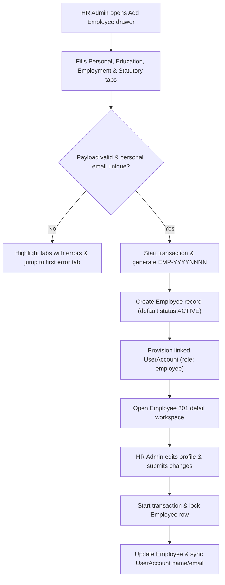

# 03 — Employee 201 Management

## 1. Purpose & Actors

Employee 201 Management maintains the authoritative master directory and personnel profile for every workforce member. Each employee is identified by a universal business key (`employee_id`) referenced across all downstream HRIS modules (scheduling, attendance, leave, online applications, and clearance setup). Onboarding an employee atomically provisions their linked login account, and profile updates keep account identity fields synchronized.

| Actor | Role in This Module |
|---|---|
| HR Administrator | Creates new Employee 201 records, updates personal/org/employment/statutory details, and reviews employee schedule and leave summaries (`employee_201` create/update). |
| Directory Viewer / Employee | Views Employee 201 directory and profile details (`employee_201` view). |
| Employee Management System | Generates unique `employee_id` codes, atomically provisions and synchronizes linked user accounts, and enforces setup referential integrity. |

---

## 2. Process Flow

*Caption: Employee 201 onboarding with automatic account provisioning and locked profile update flow.*

### Core Workflows

1. **Create Employee & Provision Account (Create):**
   - HR Admin completes the four-tab onboarding form (Personal Info, Education & Languages, Employment & Org, Statutory IDs).
   - The system validates required fields, organizational and supervisor references, and uniqueness of `personal_email` across existing user login emails.
   - Inside a single transaction, the system generates the next `EMP-YYYYNNNN` business key, defaults `employment_status` to `ACTIVE` if omitted, creates the `Employee` record, and creates the linked `UserAccount` (`name = first_name + " " + last_name`, `email = personal_email`, initial hashed password = uppercase `last_name`, default role = `employee`).
2. **Search & Filter Directory (Read List):**
   - Users search by name, `employee_id`, or personal/work email and filter by department, position, employment status, employee type, work arrangement, gender, civil status, office, employee category, or date added.
   - Reference-backed filters expand submitted values against matching setup reference codes and display names case-insensitively so historical labels and standardized codes return consistent results.
3. **View Employee 201 Profile (Read Detail):**
   - Loads the employee's full profile, organizational hierarchy relations, direct supervisor (`reports_to`), linked user account and role, plus read-only Schedule & Leave summary panels from downstream modules.
4. **Update Employee Profile (Update):**
   - Inside a transaction with a row lock on the employee record, validates uniqueness of `personal_email` (ignoring the employee's own linked user account), updates all editable profile fields, and synchronizes the linked `UserAccount` name and non-empty email.
5. **Offboarding / Separation (No Hard Delete):**
   - Physical deletion of employees is not supported. Workforce exits are recorded via `employment_status`, `separation_type`, `separation_reason`, and `separation_date` to preserve historical attendance, leave, and approval records.

---

## 3. Logical Data Schema

### Employee

| Field | Type | Required | Default | Constraints & Relationships | Purpose |
|---|---|---|---|---|---|
| id | integer | Yes | Auto-increment | PK | Surrogate internal identifier. |
| employee_id | string(30) | Yes | Generated | Unique (`EMP-YYYYNNNN`) | Universal HRIS business key referenced by all domain modules. |
| type | string(255) | No | null | Required on create | Legacy classification (`admin` / `employee`); does not grant RBAC. |
| office_id | integer | No | null | FK -> Office.id (Set Null); Indexed | Assigned office, college, campus, or branch. |
| department_id | integer | No | null | FK -> Department.id (Set Null); Indexed | Assigned department. |
| division_id | integer | No | null | FK -> Division.id (Set Null) | Assigned division. |
| section_id | integer | No | null | FK -> Section.id (Set Null) | Assigned section or unit. |
| position_id | integer | No | null | FK -> Position.id (Set Null); Indexed | Assigned job position. |
| reports_to_employee_id | string(30) | No | null | Logical ref -> Employee.employee_id | Direct supervisor's business key. |
| first_name | string(100) | Yes | — | — | Given name. |
| middle_name | string(100) | No | null | — | Middle name. |
| last_name | string(100) | Yes | — | — | Family name / surname. |
| name_extension | string(20) | No | null | — | Name suffix (e.g., Jr., Sr., III). |
| birth_date | date | No | null | — | Date of birth (`YYYY-MM-DD`). |
| birth_place | string(255) | No | null | — | Place of birth. |
| gender | string(20) | No | null | Ref -> SetupReferenceItem (`gender`) | Gender classification. |
| civil_status | string(30) | No | null | Ref -> SetupReferenceItem (`civil_status`) | Marital / civil status. |
| blood_type | string(30) | No | null | Ref -> SetupReferenceItem (`blood_type`) | Blood type classification. |
| country | string(60) | No | null | Ref -> SetupReferenceItem (`country`) | Country of origin/residence. |
| nationality | string(60) | No | null | Ref -> SetupReferenceItem (`nationality`) | Nationality. |
| citizenship | string(60) | No | null | Ref -> SetupReferenceItem (`citizenship`) | Citizenship. |
| religion | string(80) | No | null | Ref -> SetupReferenceItem (`religion`) | Religious affiliation. |
| educational_attainment | string(80) | No | null | Ref -> SetupReferenceItem (`educational_attainment`) | Highest educational level. |
| degree_course | string(120) | No | null | Ref -> SetupReferenceItem (`degree_course`) | Academic degree or course (cascades from educational attainment). |
| languages | json | No | null | Array of strings; Ref -> SetupReferenceItem (`language`) | Spoken languages list. |
| disability_type | string(80) | No | null | Ref -> SetupReferenceItem (`disability_type`) | Disability classification, if applicable. |
| personal_email | string(255) | No | null | Unique against UserAccount.email | Personal email; also used as login email. |
| mobile_no | string(30) | No | null | — | Mobile contact number. |
| telephone_no | string(30) | No | null | — | Landline contact number. |
| current_address | string(255) | No | null | — | Current residential address. |
| emergency_contact_name | string(150) | No | null | — | Emergency contact full name. |
| emergency_contact_relationship | string(60) | No | null | Ref -> SetupReferenceItem (`relationship_type`) | Relationship to emergency contact. |
| emergency_contact_no | string(30) | No | null | — | Emergency contact phone number. |
| employment_status | string(60) | No | `'ACTIVE'` | Indexed; Ref -> SetupReferenceItem (`employment_status`) | Current workforce lifecycle status. |
| employee_category | string(60) | No | null | Ref -> SetupReferenceItem (`employee_category`) | Employee category (e.g., faculty, staff). |
| appointment_type | string(60) | No | null | Ref -> SetupReferenceItem (`appointment_type`) | Appointment type (e.g., permanent, contractual). |
| employment_classification | string(60) | No | null | Ref -> SetupReferenceItem (`employment_classification`) | Employment classification. |
| work_arrangement | string(60) | No | null | Ref -> SetupReferenceItem (`work_arrangement`) | Work setup (e.g., onsite, hybrid, remote). |
| work_email | string(150) | No | null | — | Official work email address. |
| date_hired | date | No | null | — | Hire effective date. |
| regularization_date | date | No | null | — | Regularization effective date. |
| separation_type | string(60) | No | null | Ref -> SetupReferenceItem (`separation_type`) | Type of separation (e.g., resignation, retirement). |
| separation_reason | string(120) | No | null | Ref -> SetupReferenceItem (`separation_reason`) | Reason for separation (cascades from separation type). |
| separation_date | date | No | null | — | Effective date of separation. |
| tin_no | string(30) | No | null | — | Tax Identification Number. |
| sss_no | string(30) | No | null | — | Social Security System number. |
| philhealth_no | string(30) | No | null | — | National health insurance number. |
| pagibig_no | string(30) | No | null | — | Housing development mutual fund number. |
| created_at | datetime | No | null | — | Record creation timestamp. |
| updated_at | datetime | No | null | — | Record last-update timestamp. |

---

## 4. Business Rules & Invariants

1. **Unique Business Key Generation:** Every employee receives an immutable `employee_id` formatted as `EMP-{YYYY}{4-digit sequence}` (starting at `0001`). All downstream HRIS modules reference `employee_id`, never the internal numeric `id`.
2. **Atomic Account Provisioning:** Creating an employee must create both the `Employee` record and its linked `UserAccount` inside a single transaction; if either fails (e.g., duplicate email), both roll back.
3. **Default Active Status:** When `employment_status` is omitted on creation, it defaults to `ACTIVE`.
4. **Locked Profile Update & Account Sync:** Profile updates acquire an exclusive row lock inside a transaction, check `personal_email` uniqueness excluding the employee's own user account, and update the linked `UserAccount` name and non-empty email together.
5. **Valid Organizational & Supervisor References:** Any non-null `office_id`, `department_id`, `division_id`, `section_id`, `position_id`, or `reports_to_employee_id` must reference an existing record. An employee cannot report to themselves.
6. **Setup Referential Protection:** Organizational units, positions, and reference catalog items (including entries inside the `languages` JSON array) currently assigned to any employee cannot be hard-deleted from Setup modules.
7. **Case-Insensitive Setup Filter Matching:** Directory filters on setup-backed fields match both reference codes and display names case-insensitively.
8. **No Physical Employee Deletion:** Employees cannot be deleted; exits are tracked through separation fields and status updates.

---

## 5. User Interface Capabilities

- **Employee 201 Directory Screen:**
  - Server-paginated, sortable table (`id`, `employee_id`, `first_name`, `last_name`, `date_hired`, `created_at`).
  - Columns: Employee ID (link to profile), Employee (avatar, full name, email/mobile subtitle), Department & Position, Employment (type and work arrangement), Status badge (color-coded by active/warning/separated tone), Date Hired, and Contact.
  - Search bar across name, employee ID, and emails; filters for Department, Position, Status, Type, Work Setup, Gender, Civil Status, and Date Added range.
  - Permission-gated `+ Add Employee` button (`employee_201` `create`).
- **Add Employee Slide-Over Drawer:**
  - Four steppable tabs (`Personal Info`, `Education & Languages`, `Employment & Org`, `Statutory IDs`) with Previous/Next navigation and Save Employee action.
  - Validation errors place red indicator dots on affected tabs and automatically switch to the first tab containing an error.
- **Employee 201 Detail Workspace:**
  - Executive summary header plus five tabs: `Personal Info`, `Education & Languages`, `Employment & Org`, `Government & Account` (includes read-only Linked System User Account card), and read-only `Schedule & Leave` (assigned schedule history and year-selectable leave balances).
  - Permission-gated `Edit Profile` / `Save Changes` toggle (`employee_201` `update`) enables inline editing across the first four tabs.
- **Conditional & Cascading Form Behavior:**
  - Changing Office clears Department, Division, and Section; changing Department clears Division and Section; changing Division clears Section.
  - Changing Educational Attainment clears and filters Degree/Course options; changing Separation Type clears and filters Separation Reason options.
  - In edit mode, the Reports To supervisor picker excludes the employee being edited.

---

## 6. Rebuild Notes

- **Restrict Employee 201 Visibility for Regular Employees:** Currently, granting `employee_201` `view` to the baseline `employee` role exposes all coworkers' sensitive PII and statutory IDs (including via global search). Restrict non-admin users to their own 201 record or a redacted directory view.
- **Enforce 1:1 User-Employee Uniqueness & Concurrency-Safe ID Generation:** Add a database-level unique constraint on `UserAccount.employee_id`, and protect `employee_id` sequence generation with a lock or dedicated sequence table so concurrent onboarding requests cannot collide.
- **Align Validation Rules, Field Lengths & Reference Storage:** Reconcile required vs. optional onboarding fields between client and server, ensure `gender` and `civil_status` column lengths accommodate validation limits, and standardize storing reference `code` values consistently across all reference-backed columns.
- **Enforce Server-Side Hierarchy Consistency:** Validate on the server that selected `department_id`, `division_id`, and `section_id` belong to the chosen parent chain and that `reports_to_employee_id` cannot equal `employee_id`.
- **Plan Future 201 Extensions:** Consider adding employee profile photo uploads, 201 document attachments, and an immutable employment/movement history audit log.
