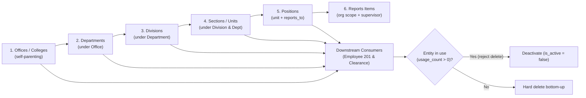
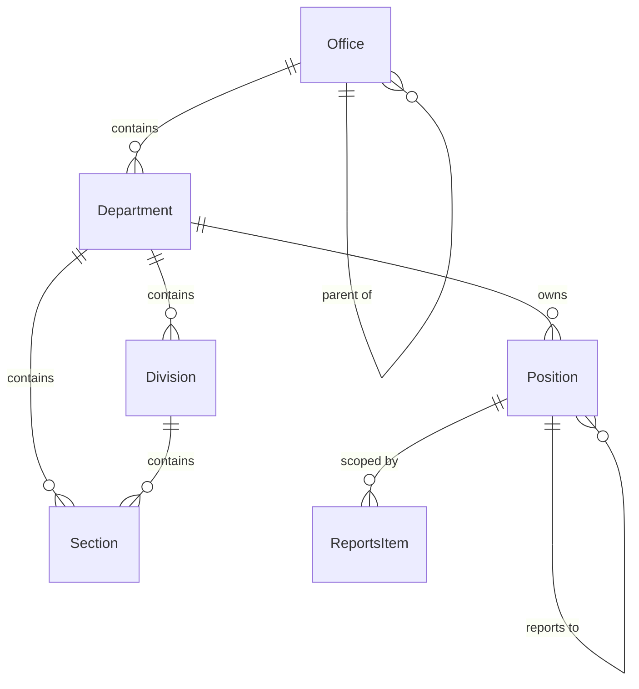

# 04 — Organizational Setup

## 1. Purpose & Actors

Organizational Setup manages the authoritative institutional hierarchy (`Offices / Colleges -> Departments -> Divisions -> Sections / Units`), the job catalog (`Positions`), and organizational reporting-line templates (`Reports Items`). Active records power cascading selectors and filters across Employee 201 and Clearance Setup while usage-protected deletion preserves historical referential integrity.

| Actor | Role in This Module |
|---|---|
| HR / System Administrator | Creates, edits, deactivates, and deletes organizational units, positions, and reporting items (`organizational_setup` grants). |
| Authenticated HRIS User | Consumes active organizational entities in dropdowns and filters across authorized modules. |
| Organizational Setup Engine | Enforces unique normalized codes, prevents ancestor/reporting cycles, synchronizes section parent chains, and blocks deletion of in-use entities. |

---

## 2. Process Flow

*Caption: Top-down organizational setup hierarchy, downstream consumption, and usage-protected lifecycle.*

### Core Workflows

1. **Create Organizational Entity (Create):**
   - Administrator selects one of the six entity types and submits required `code` and `name` (or `title` for positions) plus optional parent links, unit head (`head_employee_id`), sort order, and active flag.
   - The system trims and uppercases `code`, validates uniqueness within the entity table, verifies parent alignment (auto-populating `department_id` on sections when `division_id` is chosen), and commits inside a transaction.
2. **Update Entity & Prevent Cycles (Update):**
   - Inside a transaction with a row lock, the system validates updates.
   - For `Office.parent_id` and `Position.reports_to_position_id`, the system walks the ancestor chain to reject direct self-references and multi-hop circular hierarchies.
   - For `ReportsItem`, the system rejects setting `position_id` equal to `reports_to_position_id`.
3. **Deactivate vs. Hard Delete (Delete / Lifecycle):**
   - Every list and detail read computes `usage_count`, `is_in_use`, and a human-readable `usage_reason` across child units, employees, reports items, and clearance setup records.
   - If `is_in_use` is true, hard deletion is disabled in the UI and rejected on the server under a row lock; administrators deactivate the record (`is_active = false`) instead so it disappears from active dropdowns while keeping historical links intact.
   - Unused records (and any `ReportsItem`, which has no downstream foreign keys) may be hard-deleted in bottom-up order.
4. **Hierarchy Tree & Active Entity Lookup (Read):**
   - Administrators can retrieve a nested organizational tree (optionally including inactive units).
   - Any authenticated user can request active-only organizational options (`is_active = true`) ordered by `sort_order` and name/title for downstream forms and filters.

---

## 3. Logical Data Schema

*Caption: Core hierarchical and reporting relationships across Organizational Setup entities.*

### Office

| Field | Type | Required | Default | Constraints & Relationships | Purpose |
|---|---|---|---|---|---|
| id | integer | Yes | Auto-increment | PK | Surrogate office identifier. |
| code | string(30) | Yes | — | Unique; normalized uppercase | Unique office code. |
| name | string(150) | Yes | — | — | Full office, college, campus, or branch name. |
| short_name | string(50) | No | null | — | Optional abbreviated label. |
| type | enum(office, college, campus, branch) | Yes | `'office'` | Indexed with `is_active` | Classification of top-level unit. |
| parent_id | integer | No | null | FK -> Office.id (Set Null); acyclic | Optional parent office for nested office trees. |
| head_employee_id | string(30) | No | null | FK -> Employee.employee_id (Set Null) | Designated unit head. |
| description | string(255) | No | null | — | Optional summary. |
| sort_order | integer | Yes | 0 | Unsigned | Ascending display order. |
| is_active | boolean | Yes | true | Indexed with `type` | Controls visibility in active selectors. |
| created_at / updated_at | datetime | No | null | — | Audit timestamps. |

### Department

| Field | Type | Required | Default | Constraints & Relationships | Purpose |
|---|---|---|---|---|---|
| id | integer | Yes | Auto-increment | PK | Surrogate department identifier. |
| code | string(30) | Yes | — | Unique; normalized uppercase | Unique department code. |
| name | string(150) | Yes | — | — | Full department name. |
| short_name | string(50) | No | null | — | Optional abbreviated label. |
| office_id | integer | No | null | FK -> Office.id (Set Null); Indexed with `is_active` | Optional parent office. |
| head_employee_id | string(30) | No | null | FK -> Employee.employee_id (Set Null) | Designated department head. |
| description | string(255) | No | null | — | Optional summary. |
| sort_order | integer | Yes | 0 | Unsigned | Ascending display order. |
| is_active | boolean | Yes | true | Indexed with `office_id` | Active status flag. |
| created_at / updated_at | datetime | No | null | — | Audit timestamps. |

### Division

| Field | Type | Required | Default | Constraints & Relationships | Purpose |
|---|---|---|---|---|---|
| id | integer | Yes | Auto-increment | PK | Surrogate division identifier. |
| code | string(30) | Yes | — | Unique; normalized uppercase | Unique division code. |
| name | string(150) | Yes | — | — | Full division name. |
| short_name | string(50) | No | null | — | Optional abbreviated label. |
| department_id | integer | No | null | FK -> Department.id (Set Null); Indexed with `is_active` | Optional parent department. |
| head_employee_id | string(30) | No | null | FK -> Employee.employee_id (Set Null) | Designated division head. |
| description | string(255) | No | null | — | Optional summary. |
| sort_order | integer | Yes | 0 | Unsigned | Ascending display order. |
| is_active | boolean | Yes | true | Indexed with `department_id` | Active status flag. |
| created_at / updated_at | datetime | No | null | — | Audit timestamps. |

### Section

| Field | Type | Required | Default | Constraints & Relationships | Purpose |
|---|---|---|---|---|---|
| id | integer | Yes | Auto-increment | PK | Surrogate section identifier. |
| code | string(30) | Yes | — | Unique; normalized uppercase | Unique section code. |
| name | string(150) | Yes | — | — | Full section or unit name. |
| short_name | string(50) | No | null | — | Optional abbreviated label. |
| division_id | integer | No | null | FK -> Division.id (Set Null); Indexed with `department_id`, `is_active` | Optional parent division. |
| department_id | integer | No | null | FK -> Department.id (Set Null); must match Division's department | Optional parent department. |
| head_employee_id | string(30) | No | null | FK -> Employee.employee_id (Set Null) | Designated section head. |
| description | string(255) | No | null | — | Optional summary. |
| sort_order | integer | Yes | 0 | Unsigned | Ascending display order. |
| is_active | boolean | Yes | true | Indexed | Active status flag. |
| created_at / updated_at | datetime | No | null | — | Audit timestamps. |

### Position

| Field | Type | Required | Default | Constraints & Relationships | Purpose |
|---|---|---|---|---|---|
| id | integer | Yes | Auto-increment | PK | Surrogate position identifier. |
| code | string(30) | Yes | — | Unique; normalized uppercase | Unique position code. |
| title | string(150) | Yes | — | — | Job position title. |
| department_id | integer | No | null | FK -> Department.id (Set Null); Indexed with `is_active` | Optional owning department. |
| division_id | integer | No | null | FK -> Division.id (Set Null) | Optional owning division. |
| section_id | integer | No | null | FK -> Section.id (Set Null) | Optional owning section. |
| reports_to_position_id | integer | No | null | FK -> Position.id (Set Null); acyclic | Superior position in reporting hierarchy. |
| salary_grade | string(30) | No | null | — | Optional salary grade code (e.g., `SG-15`). |
| job_level | string(50) | No | null | — | Optional job level (e.g., Supervisory, Rank and File). |
| description | string(255) | No | null | — | Optional position summary. |
| sort_order | integer | Yes | 0 | Unsigned | Ascending display order. |
| is_active | boolean | Yes | true | Indexed with `department_id` | Active status flag. |
| created_at / updated_at | datetime | No | null | — | Audit timestamps. |

### ReportsItem

| Field | Type | Required | Default | Constraints & Relationships | Purpose |
|---|---|---|---|---|---|
| id | integer | Yes | Auto-increment | PK | Surrogate reporting-item identifier. |
| code | string(50) | Yes | — | Unique; normalized uppercase | Unique reporting-item code. |
| name | string(150) | Yes | — | — | Reporting-item label. |
| office_id | integer | No | null | FK -> Office.id (Set Null); Indexed with `department_id`, `is_active` | Optional scoped office. |
| department_id | integer | No | null | FK -> Department.id (Set Null); Indexed | Optional scoped department. |
| division_id | integer | No | null | FK -> Division.id (Set Null) | Optional scoped division. |
| section_id | integer | No | null | FK -> Section.id (Set Null) | Optional scoped section. |
| position_id | integer | No | null | FK -> Position.id (Set Null) | Optional subject position. |
| reports_to_position_id | integer | No | null | FK -> Position.id (Set Null); cannot equal `position_id` | Target superior position. |
| reports_to_employee_id | string(30) | No | null | FK -> Employee.employee_id (Set Null) | Target superior employee. |
| description | string(255) | No | null | — | Optional description. |
| sort_order | integer | Yes | 0 | Unsigned | Ascending display order. |
| is_active | boolean | Yes | true | Indexed | Active status flag. |
| created_at / updated_at | datetime | No | null | — | Audit timestamps. |

---

## 4. Business Rules & Invariants

1. **Normalized Unique Codes:** Every entity code is trimmed, uppercased, and unique within its table (`max 30` chars, or `max 50` for `ReportsItem`).
2. **Acyclic Hierarchies:** `Office.parent_id` and `Position.reports_to_position_id` must never form direct or multi-hop cycles; verified under row lock on update.
3. **Section Parent Consistency:** When a section specifies a `division_id` whose division belongs to a department, `department_id` is auto-populated if omitted and rejected with a validation error if a conflicting department is provided.
4. **No Self-Reporting Items:** A `ReportsItem` cannot have `position_id` equal to `reports_to_position_id`.
5. **Usage-Protected Deletion:** Deleting an office, department, division, section, or position is rejected with a validation error under a row lock whenever any child unit, subordinate position, employee, reports item, clearance requirement, or clearance signatory references it. Outbound unit-head references do not block deletion. `ReportsItem` deletion is unrestricted.
6. **Active-Only Shared Options:** Shared entity lookup endpoints return only `is_active = true` rows so deactivated units cannot be newly assigned in downstream modules.
7. **Master-Data Boundary:** `ReportsItem` records are reference templates only and do not automatically overwrite employee supervisors or approval routing matrices.

---

## 5. User Interface Capabilities

- **Organizational Setup Workspace:**
  - Header with a 6-card KPI summary strip (`Offices / Colleges`, `Departments`, `Divisions`, `Sections / Units`, `Positions`, `Reports Items`) showing total catalog counts; clicking a card switches the active table tab.
  - Each tab renders a server-paginated, sortable table (default sort: `sort_order asc`, `id asc`) with keyword search, `All / Active / Inactive` status filter, and entity-specific parent filters (Office type; Department by Office; Division by Department; Section by Department with cascading Division; Position by Department; Reports Item by Office and Department).
- **Create / Edit Modals:**
  - Consistent dialog layout with uppercase code formatting, active toggle (default true), sort order (default 0), and inline server validation error display.
  - Office and Position modals exclude the currently edited record from their own parent/supervisor pickers; Section modal bidirectionally cascades Department and Division selections.
- **Permission-Gated & Usage-Aware Actions (`organizational_setup`):**
  - Add buttons require `create`; Edit requires `update`; Delete requires `delete`.
  - When `is_in_use` is true, the Delete action is visually disabled with a tooltip displaying `usage_reason`.

---

## 6. Rebuild Notes

- **Decide Whether to Expose the Hierarchy View Tab:** A nested organizational tree view exists in the data model and UI components but is currently unreachable because its tab bar is hidden. Decide whether to expose it cleanly (and support arbitrary office nesting depth beyond two levels) or omit it.
- **Clarify Parent-Chain Validation on Positions & Reports Items:** Decide whether `Position` and `ReportsItem` should enforce strict parent-chain alignment (like `Section`) or intentionally allow cross-unit matrix assignments.
- **Handle Deactivated Entities in Downstream Forms:** Ensure downstream Employee 201 selectors preserve the human-readable label of a previously assigned unit even after it is deactivated, rather than falling back to a raw numeric ID.
- **Guard Employee Pickers for Non-Admin Setup Roles:** Ensure custom roles granted `organizational_setup` without `employee_201` view permission handle empty head-employee pickers gracefully without background authorization errors.
