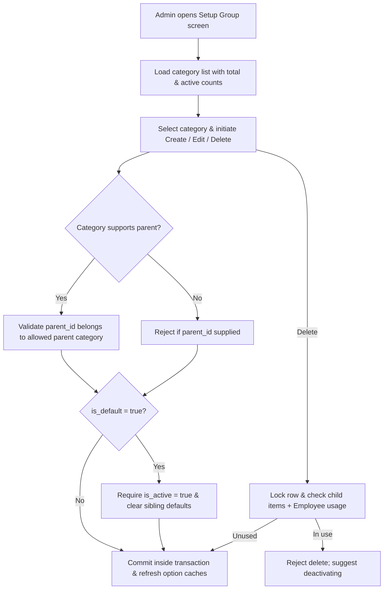
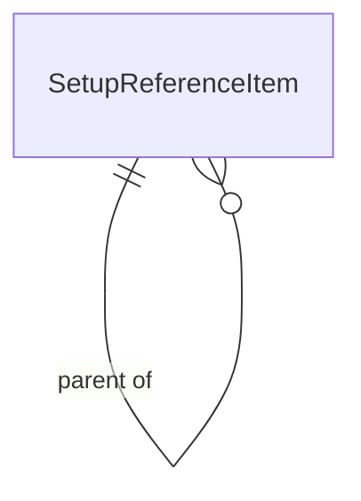

# 05 — HRIS Reference Catalogs Setup

## 1. Purpose & Actors

HRIS Reference Catalogs Setup provides a single unified master catalog (`SetupReferenceItem`) powering 25 standardized lookup categories across three logical groups—Employee Information (12 categories), Employment (8 categories), and Administrative (5 categories)—eliminating the need for 25 separate lookup tables. It supplies active dropdown options to downstream modules while enforcing single-default rules, parent-category cascades, and zero-orphan deletion protection.

| Actor | Role in This Module |
|---|---|
| HR / System Administrator | Manages reference items within their permitted setup group (`employee_info_setup`, `employment_setup`, or `administrative_setup`). |
| Authenticated HRIS User | Reads active reference options grouped by category for forms and filters across the application. |
| Reference Setup Engine | Validates group-to-category ownership, parent-category constraints, single active defaults, and live employee/child usage before deletion. |

---

## 2. Process Flow

*Caption: Reference item administration lifecycle covering parent validation, single-default switching, and usage-protected deletion.*

### Core Workflows

1. **Browse Categories & Items (Read):**
   - Opening a setup group screen loads all categories belonging to that group along with `total_count` and `active_count` summaries.
   - Selecting a category loads its server-paginated items with computed `usage_count`, `is_in_use`, and `usage_reason` metadata.
2. **Create Reference Item (Create):**
   - Administrator enters `code`, `name`, optional `description`, optional `parent_id` (only for supported child categories), `sort_order`, `is_default`, and `is_active`.
   - The system verifies `category` belongs to the active setup group, normalizes `code` to uppercase, enforces uniqueness within `(category, code)`, validates any `parent_id`, and atomically clears prior sibling defaults if `is_default = true`.
3. **Update Reference Item (Update):**
   - Locks the target row inside a transaction. `group` and `category` are immutable and ignored/stripped on update.
   - Re-validates code uniqueness, parent relationship (no self-parenting), and active-default rules, then commits and invalidates shared option caches.
4. **Delete Reference Item (Delete):**
   - Locks the target row and checks whether any child reference items or any employee records (across 19 scalar columns plus the `languages` JSON array) reference the item's code or name case-insensitively.
   - Blocks deletion with a validation error when in use; deletes physically when unused.
5. **Shared Active Option Lookup (Read):**
   - Any authenticated user can request active-only items (`is_active = true`) for one or more categories, returned grouped by category in `sort_order` sequence.

---

## 3. Logical Data Schema

*Caption: Self-referencing hierarchy on SetupReferenceItem supporting cascading category lookups.*

### SetupReferenceItem

| Field | Type | Required | Default | Constraints & Relationships | Purpose |
|---|---|---|---|---|---|
| id | integer | Yes | Auto-increment | PK | Surrogate reference-item identifier. |
| group | enum(employee_information, employment, administrative) | Yes | — | Immutable after creation; Indexed with `category`, `is_active` | Top-level setup group controlling menu authorization. |
| category | string(60) | Yes | — | Immutable after creation; Unique(category, code); Indexed | Lookup category key (25 predefined categories). |
| code | string(50) | Yes | — | Normalized uppercase; Unique(category, code) | Stable machine-readable option code. |
| name | string(150) | Yes | — | — | Display label shown in dropdowns and badges. |
| description | string(255) | No | null | — | Optional explanatory text. |
| parent_id | integer | No | null | FK -> SetupReferenceItem.id (Set Null) | Optional parent item for cascading lookups. |
| metadata | json | No | null | — | Optional category-specific attributes (e.g., ISO code, dial code, severity). |
| sort_order | integer | Yes | 0 | Unsigned | Ascending display order within the category. |
| is_default | boolean | Yes | false | At most one true per category; requires `is_active = true` | Marks the default option for the category. |
| is_active | boolean | Yes | true | Indexed with `group`, `category` | Controls visibility in active option lookups. |
| created_at | datetime | No | null | — | Record creation timestamp. |
| updated_at | datetime | No | null | — | Record last-update timestamp. |

### Category Catalog Ownership

| Group | Permission Resource | Categories |
|---|---|---|
| Employee Information | `employee_info_setup` | `gender`, `civil_status`, `blood_type`, `country`, `nationality`, `citizenship`, `religion`, `educational_attainment`, `degree_course` *(parent: `educational_attainment`)*, `relationship_type`, `language`, `disability_type` |
| Employment | `employment_setup` | `employment_type`, `employment_status`, `employee_category`, `appointment_type`, `employment_classification`, `work_arrangement`, `separation_type`, `separation_reason` *(parent: `separation_type`)* |
| Administrative | `administrative_setup` | `document_type`, `disciplinary_action_type`, `training_category`, `award_recognition_type`, `employee_requirement_type` |

---

## 4. Business Rules & Invariants

1. **Strict Group-Category Ownership:** Items can only be created or managed under the setup group that owns their `category`. Cross-group submissions are rejected with a validation error.
2. **Scoped Uppercase Code Uniqueness:** `code` is trimmed and uppercased (max 50 characters) and must be unique within `(category, code)`. Identical codes are permitted across different categories.
3. **Immutable Group & Category:** Once created, a reference item cannot be moved to another `group` or `category`.
4. **Cascading Parent Allowlist:** Only `degree_course` (parent `educational_attainment`) and `separation_reason` (parent `separation_type`) allow a non-null `parent_id`. Supplying `parent_id` for any other category, referencing a wrong-category parent, or self-parenting is rejected with a validation error.
5. **Single Active Default per Category:** An inactive item (`is_active = false`) cannot be marked `is_default = true`. Setting `is_default = true` atomically resets `is_default = false` on all other items in the same category under a lock.
6. **Usage-Protected Deletion:** Deleting an item is rejected with a validation error if it has child reference items or is referenced (by code or name, case-insensitively) on any Employee 201 scalar field or `languages` array.
7. **Batched Usage Computation:** Computing `usage_count` and `is_in_use` for category listings must use grouped queries (avoiding per-row N+1 lookups).
8. **Historical Value Preservation:** Downstream form selectors load active options only, but must preserve and display an already-saved value if that option was later deactivated.

---

## 5. User Interface Capabilities

- **Reusable Reference Setup Workspace (Used on Employee Info, Employment, and Administrative Setup Screens):**
  - **Left Category Sidebar:** Live search input filtering categories, showing each category's display name, short description, active/total count badge, and parent-category indicator when cascading applies.
  - **Right Items Table:** Server-paginated, sortable table showing Code badge, Name and description, Parent item pill (when applicable), Default star badge, Active/Inactive status pill, Usage indicator (`is_in_use` / `usage_reason`), and Edit/Delete row actions.
  - **Filters:** Keyword search, Active/Inactive status filter, and conditional Parent Item filter (rendered only when the selected category declares a parent category).
- **Create / Edit Reference Item Modal:**
  - Fields: Code (required, auto-uppercased, max 50), Name (required, max 150), Description (optional, max 255), conditional Parent Item selector, Sort Order (non-negative integer), Default checkbox (disabled/validated when inactive), and Active toggle.
  - Group and Category are read-only context once created.
- **Permission-Gated Controls:**
  - Add, Edit, and Delete actions are gated by the active setup group's menu resource (`employee_info_setup`, `employment_setup`, or `administrative_setup`).
  - Delete buttons are disabled with an explanatory tooltip whenever `is_in_use` is true.

---

## 6. Rebuild Notes

- **Standardize Stored Value Format (`code` vs. `name`):** Employee 201 currently stores display `name` for `gender` and `civil_status` while storing `code` for other reference fields. Standardize on storing `code` everywhere in a rebuild to simplify filtering and usage protection.
- **Plan Downstream Usage Protection for Administrative Categories:** The 5 administrative categories (`document_type`, `disciplinary_action_type`, `training_category`, `award_recognition_type`, `employee_requirement_type`) currently have no downstream transaction tables; wire usage-protection checks as those modules are introduced.
- **Add Actor Audit Columns:** Consider recording `created_by` and `updated_by` (or a change log) for reference catalog edits that affect HR compliance reporting.
