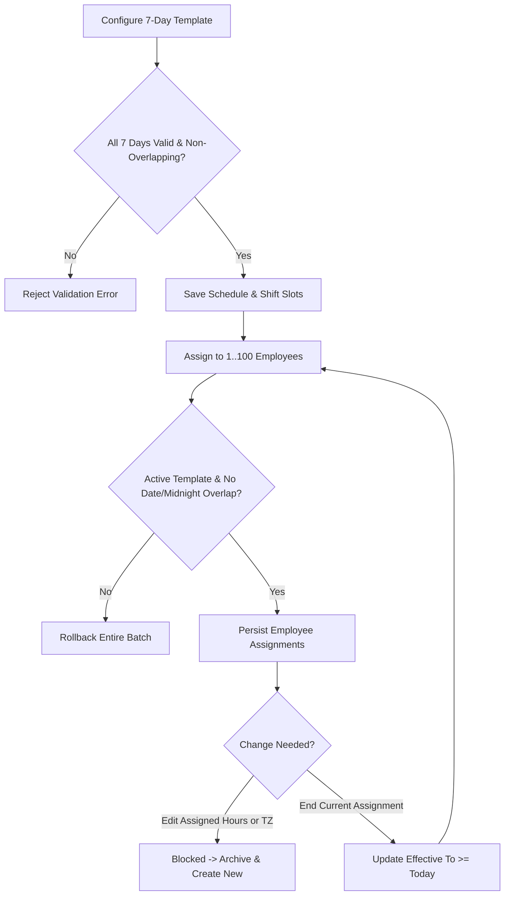
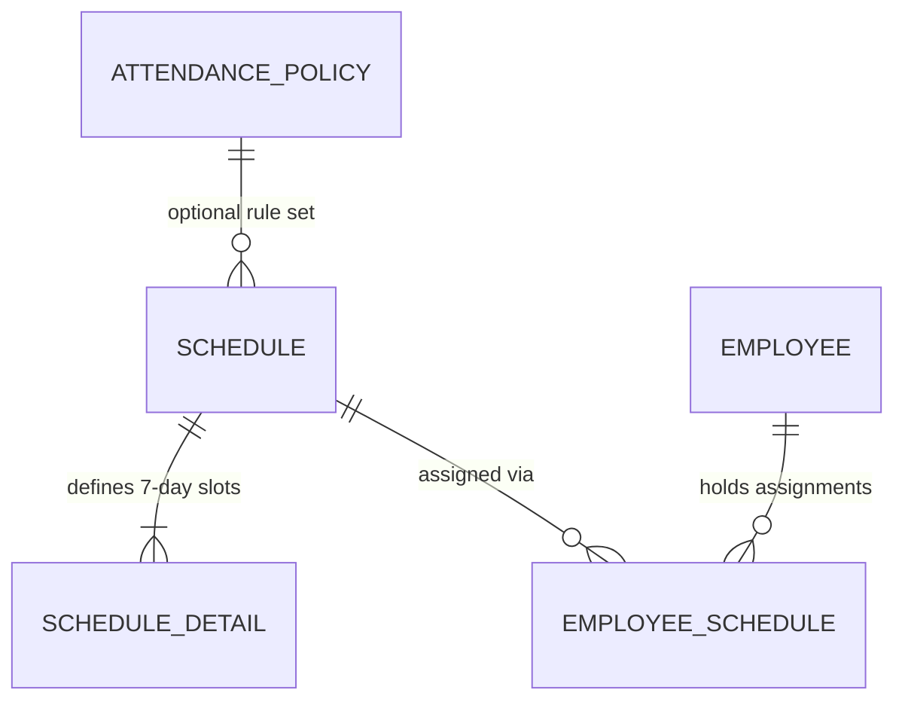

# Schedule Management

## 1. Purpose & Actors

Schedule Management defines reusable 7-day weekly work schedule templates—supporting single, split, multi-slot, rest-day, and overnight shifts—and manages non-overlapping, effective-dated employee schedule assignments. These templates and assignments serve as the authoritative baseline for Daily Time Record (DTR) evaluation, leave rest-day exclusion, and overtime shift non-overlap validation.

- **Administrator / HR Schedule Manager:** Creates and maintains weekly schedule templates, binds optional attendance policies, assigns schedules to employees in single or batch operations, and ends or transitions ongoing assignments.
- **Employee:** Views only their own schedule assignment history and resolved day-by-day calendar schedule.
- **Timekeeping & Application Modules (System):** Resolves an employee's working shifts and rest days for any calendar date to compute DTR and validate leave or overtime filings.

---

## 2. Process Flow

*Caption: Weekly schedule template lifecycle, shift-slot locking, atomic batch assignment, and assignment transition workflow.*

### Step-by-Step Workflow

1. **Template Creation:** The administrator defines a schedule name, optional IANA timezone (default `Asia/Manila`), optional linked attendance policy, active flag, and shift slots covering all 7 ISO weekdays (`1` = Monday through `7` = Sunday). The system verifies rest-day exclusivity, infers overnight shifts whenever `end_time < start_time`, and checks circular weekly non-overlap (catching Sunday night shifts that spill past midnight into Monday morning).
2. **Template Maintenance & Shift-Slot Locking:** While a template has zero employee assignments, any field—including its timezone and full set of shift slots—can be updated. Once at least one employee assignment references the template, its shift slots and timezone are locked; only the schedule name, linked attendance policy, and active status (archiving) remain editable.
3. **Atomic Batch Employee Assignment:** HR selects an active, 7-day-complete schedule template, 1 to 100 distinct employees, an inclusive start date (`effective_from`), and an optional inclusive end date (`effective_to`). Under transactional row locks on the template and target employees (locked in deterministic order), the system checks every employee for date-range overlaps and adjacent cross-midnight shift collisions (where an earlier assignment's final-day overnight shift overlaps the next assignment's first-day shift). Any single conflict rolls back the entire batch; otherwise all assignments are saved with the authenticated actor stamped as `assigned_by`.
4. **Ending & Transitioning Assignments:** To move an employee to a new schedule, HR sets `effective_to` on the current or future assignment (`effective_to >= today` in the schedule's timezone and `>= effective_from`), then creates a new assignment starting on a subsequent non-overlapping date. Past assignments cannot be modified.
5. **Per-Date Schedule Resolution:** For any employee and date span up to 366 calendar days, the system expands each date into `unassigned`, `rest_day`, or `working` entries containing timezone-aware shift start/end timestamps and total scheduled minutes.

---

## 3. Logical Data Schema

*Caption: Core relationships between attendance policies, weekly schedule templates, weekday shift slots, and employee assignments.*

### Schedule (`schedules`)

| Field | Type | Required | Default | Constraints & Relationships | Purpose |
|---|---|---|---|---|---|
| `id` | `integer` | Yes | Auto-increment | PK | Surrogate schedule template identifier |
| `name` | `string(100)` | Yes | — | — | Descriptive template name (e.g., Regular 8AM–5PM) |
| `timezone` | `string(50)` | Yes | `Asia/Manila` | Valid IANA timezone name | Timezone used for shift expansion and date-boundary checks |
| `attendance_policy_id` | `integer` | No | Null | FK -> `attendance_policies.id` (`Set Null`) | Optional linked attendance policy; falls back to system default when null |
| `is_active` | `boolean` | Yes | `true` | — | Whether the template is available for new employee assignments |
| `created_at` | `datetime` | No | Null | — | Record creation timestamp |
| `updated_at` | `datetime` | No | Null | — | Record last-update timestamp |

### Schedule Detail (`schedule_details`)

| Field | Type | Required | Default | Constraints & Relationships | Purpose |
|---|---|---|---|---|---|
| `id` | `integer` | Yes | Auto-increment | PK | Surrogate shift-slot identifier |
| `schedule_id` | `integer` | Yes | — | FK -> `schedules.id` (`Cascade`); Indexed; Unique with (`day_of_week`, `start_time`) | Parent schedule template |
| `day_of_week` | `integer` | Yes | — | Range `1..7` (ISO Monday–Sunday); Unique with (`schedule_id`, `start_time`) | Weekday the shift slot applies to |
| `code_day` | `string(3)` | Yes | Computed | Derived read-only weekday code (`M`, `T`, `W`, `TH`, `F`, `S`, `SUN`) | Short weekday label computed from `day_of_week` |
| `is_rest_day` | `boolean` | Yes | `false` | — | Marks the weekday as a scheduled rest day |
| `start_time` | `time` | No | Null | Null for rest days; Unique with (`schedule_id`, `day_of_week`) | Scheduled shift start time |
| `end_time` | `time` | No | Null | Null for rest days | Scheduled shift end time (earlier than `start_time` indicates overnight) |
| `tardy_start` | `time` | No | Null | — | Optional per-slot tardiness cutoff overriding policy grace |
| `undertime_start` | `time` | No | Null | — | Optional per-slot earliest timeout without undertime |
| `early_dismissal_start` | `time` | No | Null | — | Optional per-slot early-dismissal threshold time |
| `created_at` | `datetime` | No | Null | — | Record creation timestamp |
| `updated_at` | `datetime` | No | Null | — | Record last-update timestamp |

### Employee Schedule (`employee_schedules`)

| Field | Type | Required | Default | Constraints & Relationships | Purpose |
|---|---|---|---|---|---|
| `id` | `integer` | Yes | Auto-increment | PK | Surrogate assignment identifier |
| `employee_id` | `string(30)` | Yes | — | FK -> `employees.employee_id` (`Restrict`); Unique with `effective_from`; Indexed with (`effective_from`, `effective_to`) | Assigned employee business key |
| `schedule_id` | `integer` | Yes | — | FK -> `schedules.id` (`Restrict`) | Assigned weekly schedule template |
| `effective_from` | `date` | Yes | — | Unique with `employee_id`; Indexed with (`employee_id`, `effective_to`) | Inclusive start date of the assignment |
| `effective_to` | `date` | No | Null | Indexed with (`employee_id`, `effective_from`) | Inclusive end date of the assignment, or null if open-ended |
| `assigned_by` | `integer` | No | Null | FK -> `users.id` (`Set Null`) | Authenticated user who created the assignment |
| `created_at` | `datetime` | No | Null | — | Record creation timestamp |
| `updated_at` | `datetime` | No | Null | — | Record last-update timestamp |

---

## 4. Business Rules & Invariants

| # | Rule | Enforcement Requirement |
|---|---|---|
| 1 | **7-Day Schedule Completeness** | Every schedule template must include at least one detail entry for every ISO weekday `1` through `7`. |
| 2 | **Rest-Day Exclusivity** | When `is_rest_day = true`, `start_time` and `end_time` must be null and no second shift slot may exist on that weekday. |
| 3 | **Working Slot Validity & Overnight Inference** | Working slots require unequal `start_time` and `end_time`. When `end_time < start_time`, the shift automatically extends across midnight into the next day. |
| 4 | **Circular Weekly Non-Overlap** | No two working slots in a template may overlap—within the same day, across midnight into the next day, or wrapping from Sunday night into Monday morning. |
| 5 | **Template Immutability Once Assigned** | Once any `employee_schedules` record references a template, its shift slots (`schedule_details`) and `timezone` are locked. To change hours, archive the template (`is_active = false`) and create a new one. |
| 6 | **Active & Complete Template for Assignment** | Only active templates with all 7 weekdays configured can be assigned. Archiving a template blocks new assignments while preserving schedule resolution for existing assignments. |
| 7 | **Atomic Batch Assignment & Date Non-Overlap** | Batch assignment accepts `1..100` distinct employees. Any overlap between `[effective_from, effective_to]` and an employee's existing assignment rolls back the entire batch. |
| 8 | **Adjacent Cross-Midnight Non-Overlap** | When an assignment starts the day after another ends, the earlier assignment's final-day overnight shift must not overlap the later assignment's first-day shift. |
| 9 | **Historical Assignment Protection** | Only current or future assignments (existing `effective_to` null or `>= today` in schedule timezone) may be updated, and the new `effective_to` must be `>= today` and `>= effective_from`. |
| 10 | **Resolution Span & Access Isolation** | Per-date resolution requires `to >= from` with a maximum span of 366 calendar days. Non-admin employees may read only their own assignment history and resolved schedule. |
| 11 | **Server-Stamped Assignment Attribution** | `assigned_by` is always populated from the authenticated actor; client-supplied values are ignored. |

---

## 5. User Interface Capabilities

### Schedules Tab
- **Template List Table:** Columns for `Actions` (Edit, Delete), `Schedule` (name), `Attendance policy` (linked policy name or `System default`), `Status` badge (`Active` or `Inactive`), `Working days` (`N days / week`), and `Created` date. Supports free-text search (name, timezone), status filter, timezone filter, creation date range filter, sorting, and pagination.
- **Create / Edit Template Modal:** Includes schedule name, attendance policy selector (System default or active policies when policy-view permission is held), active schedule toggle, day-off multi-select (default Saturday & Sunday), and a 7-day shift slot editor with Start/End time pickers (default 09:00–18:00 Mon–Fri) plus per-day `Copy`, `Paste`, `Clear`, `Add row` (for split shifts), and `Delete row` controls.

### Individual Schedule Tab
- **Employee Picker & Current Banner:** Debounced employee search and selector persisted in navigation state, paired with a banner showing the employee's currently active schedule template and effective date range.
- **Assignment History Table:** Columns for `Actions` (Edit, Delete), `Schedule`, `Effective from`, `Effective to` (displays `Ongoing` when null), and `Assignment` badge (`Current` vs `History / upcoming`), with filters for schedule template, current status, and effective start date.
- **Assign / Edit Modal:** Allows selecting an active schedule template, `Effective from` date, and optional `Effective to` date. An employee's schedule history is also visible inside their individual employee profile screen.

---

## 6. Rebuild Notes

- **Deletion vs Archive-Only Lifecycle:** Currently neither schedule templates nor employee assignments support deletion at the persistence layer, even though delete actions appear in the UI. Decide whether unused templates and future-dated assignments should allow deletion or whether the UI should strictly offer Archive (templates) and End-Date (assignments) only.
- **Per-Slot Overrides, Timezone & Unpaid Breaks:** `schedule_details` stores `tardy_start`, `undertime_start`, and `early_dismissal_start` (and templates store `timezone`), while the UI does not expose them and an `unpaid_break_minutes` field is referenced in validation without a backing column. Decide which of these fields belong in the canonical contract and expose them consistently across storage, validation, and UI.
- **Batch Assignment UI & Edit Field Locking:** Expose multi-employee selection in the assignment UI to match the 1–100 employee atomic batch capability, and lock `schedule_id` and `effective_from` as read-only when editing an existing assignment (since only `effective_to` is mutable).
- **Create vs Update Permission Alignment:** Ensure users granted schedule-create permission can create templates without also requiring schedule-update permission.
