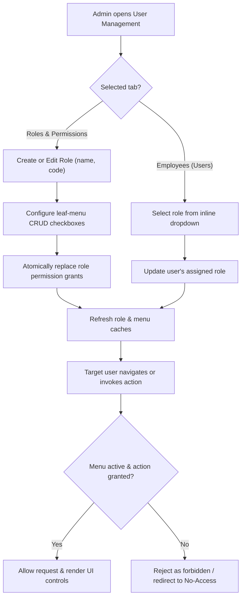
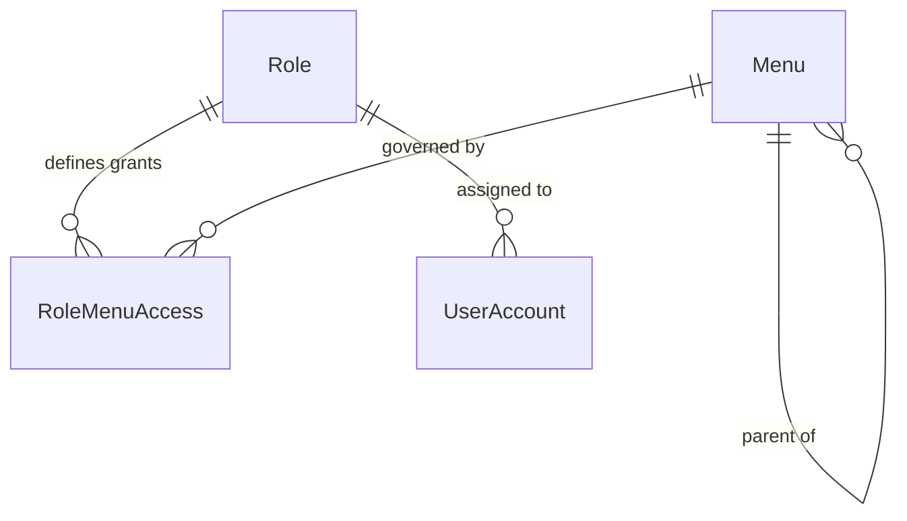

# User Management, Roles & Menu Access

## 1. Purpose & Actors

The User Management, Roles & Menu Access module provides centralized Role-Based Access Control (RBAC) across the entire HRIS. Each user account is bound to a single role, and each role holds a four-action permission matrix (`view`, `create`, `update`, `delete`) over active leaf navigation menus. This matrix simultaneously drives server-side authorization enforcement, dynamic sidebar navigation, route access guards, and UI button visibility.

| Actor | Role in This Module |
|---|---|
| System / HR Administrator | Manages roles, configures per-menu permission matrices, and assigns roles to employee user accounts (requires `user_management` grants). |
| Authenticated HRIS User | Receives a dynamically pruned navigation menu tree and action capabilities based on their assigned role. |
| Authorization Engine | Evaluates every protected request against the user's role, active menu status, and requested action (`view`, `create`, `update`, or `delete`). |

---

## 2. Process Flow

*Caption: Role administration, user-role assignment, and live menu and API permission enforcement.*

### Core Workflows

1. **Resolve Current User Navigation (Read):**
   - After sign-in, the system loads active menus joined with the user's role grants.
   - Root leaf menus without `view` access and parent section headers whose children all lack `view` access are pruned from the returned tree.
2. **Create Role & Assign Permissions (Create):**
   - Administrator enters a display name, a unique lowercase role code, and selects per-menu `view`, `create`, `update`, and `delete` flags across active leaf menus.
   - The system validates code format and uniqueness, validates that no write flag is enabled without `view`, confirms all targeted menus are active leaf items, and persists the role and its permission grants atomically.
3. **Update Role & Sync Permission Matrix (Update):**
   - Administrator renames the role (code is immutable after creation) and/or adjusts its permission checkboxes.
   - Replacing grants atomically synchronizes the role's entire grant set inside a transaction; submitting an empty grant list immediately revokes all access for users holding that role.
4. **Delete Role (Delete):**
   - Administrator triggers deletion on a custom role with confirmation.
   - The system verifies `user_management` `delete` permission, confirms the role is eligible for deletion, removes the role, and cascades removal of its permission grants.
5. **Assign Role to Employee Account (Update):**
   - Administrator selects a new role from the inline dropdown on an employee user row.
   - The system validates that the target role exists, updates the user's single `role_id`, and returns the updated user record with role details.

---

## 3. Logical Data Schema

*Caption: RBAC entities connecting roles, hierarchical menus, per-menu action grants, and user accounts.*

### Role

| Field | Type | Required | Default | Constraints & Relationships | Purpose |
|---|---|---|---|---|---|
| id | integer | Yes | Auto-increment | PK | Surrogate role identifier (seeded: 1 = Admin, 2 = Employee). |
| code | string(255) | Yes | — | Unique; immutable after creation; max 100 chars on input (`^[a-z][a-z0-9_]*$`) | Machine-readable role key (e.g., `admin`, `employee`, `hr_ops`). |
| name | string(255) | Yes | — | Max 100 chars on input | Human-readable role display name. |
| created_at | datetime | No | null | — | Record creation timestamp. |
| updated_at | datetime | No | null | — | Record last-update timestamp. |

### Menu

| Field | Type | Required | Default | Constraints & Relationships | Purpose |
|---|---|---|---|---|---|
| id | integer | Yes | Auto-increment | PK | Surrogate menu identifier. |
| code | string(255) | Yes | — | Unique | Stable resource permission code (e.g., `employee_201`, `user_management`). |
| title | string(255) | Yes | — | — | Sidebar navigation display label. |
| path | string(255) | No | null | Null for parent group headers; non-null for navigable leaf menus | Target application route path. |
| parent_id | integer | No | null | FK -> Menu.id (Restrict) | Optional parent section header for two-level navigation. |
| sort_order | integer | Yes | 0 | Unsigned | Ascending display order within the same parent level. |
| is_active | boolean | Yes | true | — | Controls whether the menu is active for navigation and authorization. |
| created_at | datetime | No | null | — | Record creation timestamp. |
| updated_at | datetime | No | null | — | Record last-update timestamp. |

### RoleMenuAccess

| Field | Type | Required | Default | Constraints & Relationships | Purpose |
|---|---|---|---|---|---|
| id | integer | Yes | Auto-increment | PK | Surrogate grant identifier. |
| role_id | integer | Yes | — | FK -> Role.id (Cascade); Unique(role_id, menu_id) | Target role receiving the grant. |
| menu_id | integer | Yes | — | FK -> Menu.id (Cascade); Unique(role_id, menu_id) | Target leaf menu item. |
| can_view | boolean | Yes | false | Required to be true if any write flag is true | Grants read and list visibility. |
| can_create | boolean | Yes | false | — | Grants record creation or submission. |
| can_update | boolean | Yes | false | — | Grants modification or approval actions. |
| can_delete | boolean | Yes | false | — | Grants record deletion. |
| created_at | datetime | No | null | — | Record creation timestamp. |
| updated_at | datetime | No | null | — | Record last-update timestamp. |

*(See Module 01 for `UserAccount.role_id`, which references `Role.id` with `Set Null`.)*

---

## 4. Business Rules & Invariants

1. **Supported Action Set:** Authorization only recognizes four actions: `view`, `create`, `update`, and `delete`. Any other action identifier must be rejected as forbidden.
2. **Active Menu Requirement:** A permission check succeeds only when the target menu exists, has `is_active = true`, and the user's role has the corresponding `can_<action> = true` grant.
3. **Role Code Format & Immutability:** On creation, `code` is required, unique, lowercase alphanumeric with underscores starting with a letter, and at most 100 characters. On update, changing `code` is prohibited; only `name` may be modified.
4. **View Prerequisite for Write Actions:** Within any menu grant row, `can_create`, `can_update`, or `can_delete` cannot be `true` while `can_view` is `false`. Violations are rejected with a validation error.
5. **Active Leaf Menus Only:** Permission grants may only target distinct, existing menus that are active (`is_active = true`) and navigable (`path` is not null). Attempting to grant access to a parent section header or inactive menu is rejected with a validation error.
6. **Atomic Full Grant Replacement:** Updating a role's access replaces its entire permission matrix within a single transaction. Omitted menus lose all grants immediately.
7. **Empty Parent Pruning:** The current-user navigation tree omits any leaf menu lacking `can_view` and omits any parent section header that has zero visible children.
8. **Single Role per User & Default Assignment:** Each user account holds at most one role. Newly provisioned user accounts default to the `employee` role when no explicit role is provided.
9. **Legacy Employee Type Ignored for RBAC:** An employee's legacy `type` classification (`admin` / `employee`) never grants or escalates RBAC permissions; only the assigned role and its menu grants are authoritative.
10. **Seeded Baseline Roles:** The system ships with two baseline roles: `admin` (full CRUD across all active leaf menus) and `employee` (`view` on Dashboard and Employee 201; `view`, `create`, and `update` on online self-service applications). Re-seeding preserves customized grants on existing `(role_id, menu_id)` pairs.

---

## 5. User Interface Capabilities

- **User Management Screen (Two Tabs, URL-Synchronized):**
  - **Employees (Users) Tab (Default):**
    - Server-paginated, sortable table (`id`, `employee_id`, `name`, `email`, `role_id`, `created_at`).
    - Columns: Employee (avatar, display name, email), Employee ID, Email, Current Role badge, and inline Access Role selector.
    - Search across name, email, and employee ID; filters for Role (multi-select) and Date Created range.
    - Changing the inline Access Role dropdown immediately updates the user's role; dropdowns disable while saving.
  - **Roles & Permissions Tab:**
    - Server-paginated, sortable table (`id`, `code`, `name`, `created_at`).
    - Columns: Actions (Edit, Delete), Name, Code, Created At.
    - Search across name and code; filters for Code and Date Created range.
    - **Role Modal Form:** Role Name input, Role Code input (disabled in edit mode), and a 4-column permission checkbox matrix grouped by parent menu section (showing active leaf menus only). Checking `create`, `update`, or `delete` automatically checks `view`; unchecking `view` automatically clears all write checkboxes.
    - **Delete Confirmation Dialog:** Confirms role removal and surfaces server errors inline.
- **No-Access Screen:**
  - Dedicated access-denied view ("Access unavailable") with a "Back to dashboard" link, shown whenever a user navigates to a route without `view` permission.
- **Permission-Gated Controls (`user_management`):**
  - Inline role assignment dropdown requires `update`.
  - Creating a new role requires `create` (and `update` if role creation and grant assignment are separate calls); editing requires `update`; deleting requires `delete`.
  - Read-only `view` users see tables and current role badges with all mutating controls hidden.

---

## 6. Rebuild Notes

- **Fix Role Deletion End-to-End:** In the legacy implementation, role deletion failed because the authorization check used an unsupported action name (`destroy` instead of `delete`) and mismatched path vs. body identifiers. In a rebuild, enforce `user_management` `delete`, identify the role strictly by its path/resource ID, and protect against deleting seeded system roles (`admin`, `employee`) or roles still assigned to active users.
- **Make Role Creation + Grant Assignment Single-Step Atomic:** Accept initial permission grants directly in the role-creation operation inside a single transaction so partial failures cannot leave an empty role behind.
- **Prevent Self-Lockout:** Disallow administrators from demoting their own role or stripping `user_management` access from the `admin` role without another active administrator.
- **Clean Up Legacy Placeholder Routes:** Omit unused placeholder module slugs that have no backing menu entries, and add actor audit logging (`updated_by` / change history) for role and permission changes.
